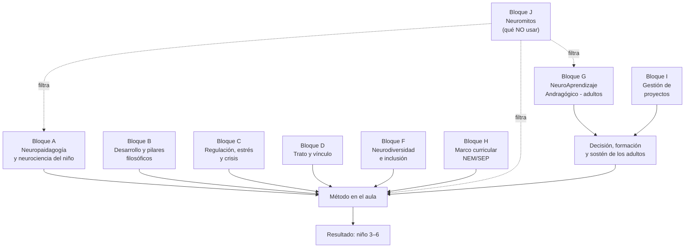

# Glosario Neuroeducativo

## Documento base previo al Acta Constitutiva del proyecto

*Versión 1.0 · Proyecto de desarrollo pedagógico preescolar (3–6 años) · Serie documental: (1) informe de neuroeducación, (2) análisis e integración con el Programa Sintético, (3) estrés/crisis/calma/entornos, (4) **este glosario** · Fecha: 26 de septiembre de 2026*

---

## 0. Preámbulo: para qué sirve este glosario

**Propósito.** Que padres, tutores, profesores, aprendientes, estudiantes, directivos, sponsors, stakeholders, managers y cualquier participante del proyecto **compartan un mismo léxico**, de modo que el Acta Constitutiva y todas las decisiones de arquitectura sean **comprensibles, trazables, observables y aceptables** para todos los involucrados.

**Por qué incluye andragogía además de paidagogía.** Prácticamente todos los actores del proyecto son adultos: sponsors, stakeholders, managers, tutores, profesores y familias. La mayor parte del contenido del proyecto debe ser **discutido, decidido y aprendido entre adultos**; los niños son el destinatario final del resultado de esos adultos. Por eso el glosario separa dos campos:

- **Neuropaidagogía** (bloque A): cómo aprende el cerebro del niño de 3–6.
- **Neuroandragogía / NeuroAprendizaje Andragógico** (bloque G): cómo aprende el cerebro del adulto que decide, enseña, financia y acompaña.

> **Principio de Consecuencia Adulta (P0):** *el niño es la consecuencia del resultado de los adultos con los que convive*. La evidencia lo respalda: serve and return, co-regulación y ecosistemas del desarrollo (Bronfenbrenner) muestran que el adulto es la variable ambiental de mayor impacto sobre el niño. Un proyecto que forma solo a los niños y no a los adultos no escala.

### Fundamentos transversales — Axiomas del programa (AX-1..3) *(capa de la Segunda Tanda, en el preámbulo junto a P0)*

> Fuente verbatim: `Primera Tanda/basesconceptuales.md` · Fuente canónica con anclaje y guardas: `fundamentos-axiomas-del-programa.md`.

**[AX-1] · Toda información es útil: el error informa; hacer da más información que no hacer..** **Expresión en este glosario:** B19 (práctica basada en evidencia), E4/E6 (evaluación formativa y feedback), I16 (retrospectiva), G25 (seguridad psicológica)
**[AX-2].** **Axioma (síntesis):** Los niños son el resultado de los adultos y de la realidad material directa; el adulto es su historia e infancia. · **Expresión en este glosario:** **P0 / G22** (Principio de Consecuencia Adulta = formulación operativa de AX-2), A19 (serve and return), C2 (co-regulación)
**[AX-3].** **Axioma (síntesis):** La resignificación: ver matices, no binarismos; sus crisis, acompañadas, nutren al individuo y su entorno. · **Expresión en este glosario:** G10 (doble bucle), G6 (andragogía transformacional), bloque J (neuromitos como tarea de resignificación)

*Mapa unificado de principios*: **nivel fundacional** = AX-1..3 · **nivel operativo** = P0–P3 (este preámbulo), T1–T4 (D6), B26/B19 (D5), 6 principios de IA (D6 §5.5), bloque J. Ninguna etiqueta existente se modifica.

**Convenciones de trazabilidad:**

**[I1].** `neuroeducacion-preescolar-3-6-informe.md` (informe base)
**[I2].** `analisis-programa-sintetico-integracion-neuroeducacion.md`
**[I3].** `estres-crisis-calma-y-entornos-seguros-3-6.md`
**[PS].** Plan de Estudio 2022 / Programa Sintético Fase 2 (SEP, 2024)
**[PM].** Modelo de gestión de proyectos del proyecto
**(autor, año).** Fuente externa citada en Referencias

**Cómo leerlo según su rol (lectura mínima sugerida):**

**Sponsors / directivos / managers.** P0, G, H, I, J
**Profesores y tutores.** A, B, C, D, E, F, H
**Familias y padres.** C, D, F, J + preámbulo
**Estudiantes / aprendientes.** A, B, E, G
**Todos (sesión de arranque).** P0 + reglas de lenguaje + índice

**Mapa conceptual de los bloques:**

---

## Carta de importancia conceptual: el termómetro del glosario

Antes de entrar a los bloques, conviene saber **qué pesa más**. Este glosario ordena cada término en un termómetro de tres niveles, que aparece al lado de cada entrada como *Nivel I · Pilar*, *Nivel II · Clave* o *Nivel III · Complementario*:

- **Nivel I · Pilar.** Son los conceptos que sostienen todo el edificio: si de algo no se puede prescindir, es de éstos. Corresponden a los pilares filosóficos y a las mecánicas fundacionales del desarrollo.
- **Nivel II · Clave.** Conceptos operativos: los que un docente, un manager o una familia necesitan manejar cada semana para trabajar bien. Son el vocabulario vivo del proyecto.
- **Nivel III · Complementario.** Conceptos de apoyo, ampliación o contexto administrativo. Enriquecen la comprensión, pero el proyecto no se cae si se ignoran temporalmente.

**Los pilares filosóficos planteados en los documentos** (fuente: `Pilares-filosoficos.md` y `fundamentos-axiomas-del-programa.md`) son: el tríptico **LAIRE** —Legalidad, Ambientalidad, Individualidad, Relacionalidad y Ética—; el eje de **Neurociencias** —neuroeducación, neuroandragogía, neuropaidagogía, neuropsicología y neurodesarrollo—; la **Interseccionalidad**; la **Antipsiquiatría** —crítica a la medicalización de la conducta—; la **Ideología y sus aparatos ideológicos**; el **Materialismo histórico**; la **Escuela Mexicana**; y las **Convenciones de los Niños**. Sobre ellos se recuestan los tres **axiomas fundacionales AX-1, AX-2 y AX-3**: toda información es útil; los niños son el resultado de los adultos y de la realidad material; y la resignificación es la labor más necesaria.

**Conceptos clave (Nivel I y selección de Nivel II)** organizados por familia:

- *Biología del desarrollo*: neuroeducación, neuropaidagogía, arquitectura cerebral, funciones ejecutivas, estrés tóxico, serve and return, corteza prefrontal, ventana de tolerancia.
- *Aprendizaje y vínculo*: constructivismo, socioculturalismo, zona de desarrollo próximo, apego, teoría de la mente, práctica basada en evidencia, principio de no daño.
- *Regulación y trato*: autorregulación, co-regulación, estilo autoritativo, alta exigencia y alta calidez, validación emocional, reparación frente a castigo.
- *Método*: práctica apropiada al desarrollo (DAP), juego libre, evaluación formativa, preguntas de orden superior, role-play, secuenciación espiral, lectura de la realidad.
- *Personas y proyecto*: neurodiversidad, neuroafirmación, andragogía, neuroandragogía, principio de Consecuencia Adulta, seguridad psicológica, gobernanza, trazabilidad.

**Conceptos complementarios (Nivel III)** son la segunda corona del saber: biología elemental (neurona, sinapsis), contrastes históricos (conductismo, inteligencias múltiples), categorías finas (alexitimia, deuda sensorial, hiperfoco) y referencias administrativas (entregable, hito, cronograma). Sirven para profundizar, no para empezar.

**Cómo se relacionan.** La cadena típica de lectura es **pilar → clave → complementario**: el Materialismo histórico (pilar) sustenta el axioma AX-2, que se operativiza como Principio de Consecuencia Adulta (pilar G22), que a su vez se traduce en andamiaje profesional (clave G18) y se documenta con trazabilidad (clave I15). Cada entrada de Nivel I incluye al final la nota *Se relaciona con…*, que muestra sus vecindades; las definiciones mismas conservan las referencias cruzadas (p. ej. «ver G12») que tejen el resto de la red. Léase, pues, en espiral: nadie domina un término sin visitar a sus vecinos.

*Nota sobre el bloque J*: los neuromitos no reciben nivel porque pertenecen al termómetro invertido: su importancia consiste en **no usarse**.

## Bloque A — Neuropaidagogía y neurociencia del desarrollo (3–6 años)

Abrimos el glosario por su base biológica: lo que ocurre, literalmente, dentro de la cabeza de un niño de 3 a 6 años. Convéntese de que cada práctica del aula —una conversación, un abrazo, un juego— se traduce en sinapsis que se fortalecen y en circuitos que se podan. Estos términos no son curiosidad científica: son la explicación material de por qué el trato, el juego y el ambiente importan tanto.

**A1 · Neuroeducación** · *Nivel I · Pilar.* Campo interdisciplinario que aplica hallazgos de neurociencia y psicología del diseño y la práctica educativa. No es "enseñar neurociencia a los niños" sino **enseñar mejor a los niños con base en cómo aprende el cerebro**. *([I1] Marco del proyecto)* *(Se relaciona con: A2, B19, G1)*
**A2 · Neuropaidagogía** · *Nivel I · Pilar.* Rama de la neuroeducación centrada en el aprendizaje **infantil** (aquí, 3–6 años): ventanas de desarrollo, juego, regulación, lenguaje. *([I1] Bloque A del glosario)* *(Se relaciona con: A1, G2, E3)*
**A3 · Neurona** · *Nivel III · Complementario.* Célula que procesa y transmite información mediante señales eléctricas y químicas. *([I1 §3.1])*
**A4 · Sinapsis** · *Nivel III · Complementario.* Punto de conexión entre neuronas; su fuerza determina qué circuitos se usan y cuáles se debilitan. "Las que no se usan, se debilitan". *([I1 §3.1])*
**A5 · Sinaptogénesis** · *Nivel III · Complementario.* Formación masiva de sinapsis; en los primeros años se crean **más de 1 millón de conexiones por segundo**. *(Harvard/NSCDC [I1 §3.1])*
**A6 · Poda sináptica (pruning)** · *Nivel III · Complementario.* Eliminación selectiva de sinapsis poco usadas para hacer los circuitos eficientes; es normal y necesaria. *([I1 §3.1])*
**A7 · Mielinización** · *Nivel III · Complementario.* Revestimiento de los axones que acelera la transmisión; explica por qué ciertas habilidades se vuelven automáticas con la práctica. *([I1 §3.1])*
**A8 · Arquitectura cerebral** · *Nivel I · Pilar.* Estructura física de las redes cerebrales construida por **genética + experiencia**; la genética da el plano, la experiencia decide la calidad. *(Harvard [I1 §3.1])* *(Se relaciona con: A5, A6, A9, A18)*
**A9 · Neuroplasticidad** · *Nivel II · Clave.* Capacidad del cerebro de cambiar por la experiencia; máxima al inicio de la vida y **presente toda la vida** (ver G12). *([I1 §3.1])*
**A10 · Periodo sensible / ventana crítica** · *Nivel II · Clave.* Etapa en la que un circuito se configura con especial facilidad (lenguaje, orden, refinamiento sensorial-motor a los 3–6). **Ojo:** la ventana extrema "si no se estimula antes de 3, se pierde" es falso (J6). *(Montessori; Knudsen [I1 §4.1, §3.5])*
**A11 · Corteza prefrontal** · *Nivel II · Clave.* Región del "freno" y la planificación; madura hacia los 18–20 y sigue afinándose hasta los ~25. **Por eso un niño de 3–6 no "reacciona como un adulto".** *(NIMH; Hardy 2023 [I1 §2.3])* *(Se relaciona con: A12, A17, G12)*
**A12 · Funciones ejecutivas (EF)** · *Nivel I · Pilar.* Familia de capacidades que permiten "jugar mentalmente con las ideas, pensar antes de actuar y adaptarse": inhibición, memoria de trabajo y flexibilidad cognitiva. *(Diamond 2013 [I1 §3.4])* *(Se relaciona con: A13, A14, A15, C1, G13)*
**A13 · Inhibición de respuesta** · *Nivel II · Clave.* Freno de los impulsos; primera EF en madurar (esperar turnos, no correr a la calle). Se entrena en juego de reglas. *([I1 §3.4, §6.4])* *(Se relaciona con: A12, E15)*
**A14 · Memoria de trabajo** · *Nivel II · Clave.* Mantener y manipular información en mente (recordar un protocolo de 3 pasos). Límite corto a esta edad. *([I1 §3.4])*
**A15 · Flexibilidad cognitiva** · *Nivel II · Clave.* Cambiar de estrategia o perspectiva; se construye sobre las dos anteriores, hacia fin de preescolar/primaria. *([I1 §3.4])*
**A16 · Amígdala** · *Nivel II · Clave.* Centro de detección de amenaza; activa la alarma antes de que la corteza prefrontal responda. En crisis, "primero alarma, luego razón". *([I1 §3.3])*
**A17 · Eje HHA (hipotálamo-hipófisis-adrenal)** · *Nivel II · Clave.* Sistema hormonal de la respuesta al estrés; si se activa de forma excesiva o prolongada sin apoyo, produce estrés tóxico. *(NSCDC [I1 §3.3])*
**A18 · Estrés tóxico / tolerable / positivo** · *Nivel I · Pilar.* Tóxico: activación intensa o prolongada **sin adulto de apoyo** (daña arquitectura cerebral). Tolerable: fuerte pero amortiguada. Positivo: reto con acompañamiento (fortalece). *(Harvard [I1 §3.3; I3 §1.1])* *(Se relaciona con: A17, C4, C9, C19)*
**A19 · Serve and return (servir y devolver)** · *Nivel I · Pilar.* Intercambio ida y vuelta adulto-niño (el niño señala → el adulto responde); construye lenguaje, vínculo y bienestar social. *(Harvard [I1 §3.2])* *(Se relaciona con: B12, C2, D10, G22)*
**A20 · Estado de activación (arousal)** · *Nivel II · Clave.* Nivel de alerta del sistema nervioso: ni muy bajo (distracción) ni muy alto (colapso). El objetivo es el **nivel óptimo**, no la quietud total. *([I3])*
**A21 · Interocepción / exterocepción** · *Nivel II · Clave.* Percibir el interior del cuerpo (hambre, dolor, vejiga) / el exterior (ruido, tacto). Diferencias en la interocepción explican crisis "sin causa visible". *([I3 §2.1])*
**A22 · Neurotransmisores** · *Nivel III · Complementario.* Mensajeros químicos (dopamina, serotonina, GABA…). Evitar simplificaciones: la dopamina no es "la molécula del placer" sino de **seguimiento de metas y aprendizaje**. *([I1 §3.5])*
**A23 · Lateralización hemisférica** · *Nivel III · Complementario.* Existe especialización (el lenguaje suele ser más izquierdo), pero **cooperan siempre**; no hay "personas de izquierda o de derecha" (ver J2). *([I1 §3.5])*

---

## Bloque B — Psicología del desarrollo, aprendizaje y pilares filosóficos

Si el bloque A describe el hardware, éste describe el software del desarrollo: cómo el ser humano construye conocimiento, vínculo y sentido. Aquí conviven las grandes tradiciones —Piaget, Vygotsky, Bowlby, Freire, Bourdieu— con las preguntas éticas que acompañan al proyecto. Léase con calma: son los lentes con los que después leeremos cualquier situación del aula.

**B1 · Constructivismo** · *Nivel I · Pilar.* El sujeto **construye** su conocimiento interactuando con el mundo; no lo recibe pasivamente. Filosofía rectora del proyecto. *(Piaget [I1 §3.6])* *(Se relaciona con: B2, B3, E13)*
**B2 · Esquema, asimilación, acomodación, equilibración** · *Nivel III · Complementario.* Esquema = patrón de acción; asimilarlo = encajar lo nuevo en lo que sé; acomodarlo = cambiar mi esquema; equilibración = buscar coherencia. Cómo aprende de verdad. *(Piaget [I1 §3.6])*
**B3 · Etapa preoperacional (2–7 años)** · *Nivel II · Clave.* Pensamiento **simbólico y egocéntrico**, sin lógica formal ni conservación. Implica: exigir razonamiento abstracto a los 3–6 es **frustración innecesaria**. *(Piaget [I1 §2.4])*
**B4 · Pensamiento simbólico / función simbólica** · *Nivel II · Clave.* Representar algo con otro thing (un palo = caballo). Base del juego pretendido, la escritura y el conteo. *(Piaget [I1 §4.1])*
**B5 · Egocentrismo (sentido piagetiano)** · *Nivel III · Complementario.* No es "egoísmo": es **dificultad para tomar la perspectiva del otro** antes de ~5 años (madura con la teoría de la mente). *(Piaget [I1 §3.6])*
**B6 · Conservación** · *Nivel III · Complementario.* Entender que la cantidad no cambia al modificar la forma (misma agua en vaso alto o bajo). A los 3–6 **aún no se conserva**; es un error esperable, no ignorancia. *(Piaget [I1 §2.4])*
**B7 · Socioculturalismo** · *Nivel I · Pilar.* El aprendizaje es **social y cultural**; primero interpersonal (con otro), luego intrapersonal (propio). *(Vygotsky [I1 §3.6])* *(Se relaciona con: B8, B9, E3)*
**B8 · Zona de desarrollo próximo (ZDP)** · *Nivel I · Pilar.* Distancia entre lo que el niño hace solo y lo que hace **con ayuda**. Enseñar ahí es el punto óptimo: ni fácil (aburrido) ni imposible (frustrante). *(Vygotsky [I1 §3.6])* *(Se relaciona con: B9, E3, E18)*
**B9 · Andamiaje (scaffolding)** · *Nivel II · Clave.* Apoyo temporal que se da y **se retira** según el niño pueda. El adulto no resuelve: acompaña y luego se retira. *(Wood, Bruner & Ross 1976 [I1 §3.6])*
**B10 · Teoría de la mente** · *Nivel II · Clave.* Comprender que otros tienen deseos, creencias y emociones **distintos** a los propios; base de empatía y cooperación. *(Wellman et al. 2001 [I1 §4.2])*
**B11 · Creencias falsas** · *Nivel II · Clave.* Entender que alguien puede creer algo que no es real (madura ~4½–5 años); hito central de la teoría de la mente. *(Wellman 2001 [I1 §4.2])*
**B12 · Apego** · *Nivel I · Pilar.* Vínculo afectivo duradero con el cuidador principal; la seguridad del apego condiciona exploración y regulación. *(Bowlby/Ainsworth [I1 §5])* *(Se relaciona con: B13, C2, A19)*
**B13 · Base segura** · *Nivel II · Clave.* Desde el apego seguro el niño **explora y se arriesga** porque sabe que hay un refugio al que volver. El adulto es esa base. *(Bowlby [I1 §6.6])*
**B14 · Cognitivismo** · *Nivel III · Complementario.* Enfoque que estudia procesos internos (atención, memoria, resolución de problemas); fuente de la teoría de la carga cognitiva (G13). *([I1])*
**B15 · Conductismo / behaviorismo** · *Nivel III · Complementario.* Enfoque centrado en estímulo-respuesta y refuerzo; útil para ciertas técnicas (modelado, entrenamiento conductual) pero **insuficiente** como visión completa del aprendizaje. *(Contraste en [I1])*
**B16 · Modelado / aprendizaje vicario** · *Nivel II · Clave.* Aprender observando a otros y sus consecuencias. Los niños **y los adultos** aprenden así: el docente es el modelo más observado del aula. *(Bandura [I1 §5.2])*
**B17 · Ecosistemas del desarrollo** · *Nivel II · Clave.* Cada niño está inmerso en microsistema (familia/aula), mesosistema (escuela-familia), exosistema y macrosistema; intervenir solo en el aula es insuficiente. *(Bronfenbrenner [I2 §4.2])*
**B18 · Modelo médico vs. modelo social de la discapacidad** · *Nivel II · Clave.* Médico: el déficit está en la persona. Social: el problema está en barreras del entorno. **El proyecto adopta el modelo social + neuroafirmación (F11).** *(Filosofía del proyecto [I3 §5.4])*
**B19 · Práctica basada en evidencia (EBP)** · *Nivel I · Pilar.* Decisión pedagógica sustentada en la mejor evidencia disponible + experiencia profesional + contexto. **Filtro obligatorio** de todo material "neuro-". *([I1 §3.5])* *(Se relaciona con: B26, E4, I15)*
**B20 · Pensamiento crítico** · *Nivel II · Clave.* "Juicio deliberado y autorregulado" de interpretar, analizar, evaluar, inferir y explicar con base en evidencia (versión adulta); en 3–6: preguntar, comparar, notar lo raro. *(Facione 1990; OCDE [I1 §2.2, §4.2])*
**B21 · Metacognición** · *Nivel II · Clave.* "Pensar sobre el propio pensar": saber qué sé, qué no sé y qué estrategia uso. Precursor en 3–6: revisar su propio error. *([I1 §4.2])*
**B22 · Motivación intrínseca / extrínseca y efecto de sobrejustificación** · *Nivel II · Clave.* Hacer algo por interés propio / por recompensa externa. Premiar lo que ya gusta **socava** la motivación interna. *(Deci & Ryan 1987 [I3 §5.5])*
**B23 · Orientación a dominio vs. rendimiento** · *Nivel II · Clave.* Dominio: aprender y mejorar. Rendimiento: parecer competente y evitar el error. Elogiar el talento fijo induce rendimiento; elogiar estrategia y esfuerzo induce dominio. *([I1 §5.4])*
**B24 · Inteligencias múltiples** · *Nivel III · Complementario.* Modelo descriptivo de Gardner (8 capacidades humanas). **Útil como repertorio, NO como taxonomía validada ni diagnóstico** (crítica de la comunidad científica). *(Gardner 1983; críticas [I1 §2.1])*
**B25 · Inteligencia emocional** · *Nivel II · Clave.* Versión académica (Salovey-Mayer): percibir, comprender y regular emociones propias y ajenas. Versión popular (Goleman): competencias de liderazgo, con método más criticado. *([I1 §2.1])*
**B26 · Principio de no daño (primum non nocere)** · *Nivel I · Pilar.* Ninguna práctica del proyecto puede dañar el bienestar del niño o del adulto en nombre de "resultados". Límite ético del Acta Constitutiva. *([I1 §7; I3])* *(Se relaciona con: A18, C19, F11)*
**B27 · Pensamiento crítico adulto vs. infantil (continuidad)** · *Nivel II · Clave.* El estándar adulto es la **meta**; el niño de 3–6 construye **precursores**. No se evalúa al niño con criterios de adulto. *([I1 §2.4])*

---

## Bloque C — Regulación, estrés y crisis

La regulación emocional es el Puente entre lo que el niño siente y lo que puede hacer con lo que siente. En este bloque recorremos la escalera completa: desde la co-regulación que ofrece el adulto, pasando por las crisis que parecen caos pero comunican, hasta las estrategias que devuelven la calma. Quien domine este vocabulario podrá leer una crisis en lugar de sufrirla.

**C1 · Autorregulación** · *Nivel I · Pilar.* Capacidad propia de modular emoción, atención y conducta. **No nace: se construye** desde la co-regulación. *([I1 §5.1])* *(Se relaciona con: C2, A12, G23)*
**C2 · Co-regulación** · *Nivel I · Pilar.* Interacciones cálidas y responsivas en las que el adulto **ayuda al niño a regularse**: se regula primero, valida, modela y devuelve la estrategia. **Palanca #1 del proyecto.** *(NAEYC; Murray 2015 [I1 §5.1; I3])* *(Se relaciona con: C1, A19, D1, G22)*
**C3 · Regulación / desregulación emocional** · *Nivel II · Clave.* Modular la emoción adecuadamente / perder el control (explosión o cierre). En preescolar la desregulación es **esperable**, no patológica. *([I1 §4.3])*
**C4 · Ventana de tolerancia** · *Nivel II · Clave.* Rango de activación en el que la persona puede pensar y aprender. Por debajo: apagón (shutdown); por encima: colapso (meltdown). **El adulto mantiene al niño dentro de su ventana.** *(Siegel [I3])* *(Se relaciona con: C2, A18, C16)*
**C5 · Rabieta (tantrum)** · *Nivel II · Clave.* Exabrupto con **meta** (obtener o evitar algo). Común: ~1/día a los 3–4 años es promedio. Se enseña con espera y alternativas. *(Hoyniak 2022 [I3 §1.2])*
**C6 · Colapso (meltdown)** · *Nivel II · Clave.* **Falla del sistema por sobrecarga**; no es voluntario ni manipulador. Se protege, no se razona. *([I3 §1.2])*
**C7 · Cierre (shutdown)** · *Nivel II · Clave.* Retirada y "apagón" como respuesta a la sobrecarga; también no es desobediencia. *([I3 §1.2])*
**C8 · Cadena rumbling → rage → recovery** · *Nivel II · Clave.* Fases de la crisis: señales tempranas → explosión → recuperación. **Intervenir en "rumbling" evita la mayoría de las crisis.** *(Myles & Southwick [I3 §1.3])* *(Se relaciona con: C19, C16, C20)*
**C9 · Sobrecarga sensorial** · *Nivel II · Clave.* Exceso de estímulos (ruido, luz, multitudes, texturas) que rebasa la capacidad de procesamiento y dispara la alarma. *([I3 §2.2])*
**C10 · Hiperreactividad / hiporreactividad sensorial** · *Nivel II · Clave.* Respuesta exagerada ("¡no me toques!") o apagada ("no siente dolor/frío") ante estímulos. Ambas son conductas de regulación, no capricho. *(Raevsky 2025 [I3 §1.4])*
**C11 · Estimulación reguladora (stimming)** · *Nivel II · Clave.* Repeticiones (girar, aletear, sonidos) que **regulan**. Se permite salvo daño; suprimirla sin sustituto **aumenta** la crisis. *(Neuroafirmación [I3 §5.4])*
**C12 · Monotropismo** · *Nivel II · Clave.* Estilo de atención de **foco intenso y único**; explica intereses profundos y el coste de las interrupciones. Recurso didáctico, no defecto. *(Murray et al. [I3 §3.4])*
**C13 · Alexitimia** · *Nivel III · Complementario.* Dificultad para identificar y nombrar las propias emociones; común en algunos perfiles ND; se compensa con vocabulario emocional externo. *([I3 §2.6])*
**C14 · Resiliencia** · *Nivel II · Clave.* Capacidad de recuperarse de la adversidad **con apoyo**; no es "aguantar solo". *([I1 §2.3])*
**C15 · Frustración innecesaria vs. productiva** · *Nivel II · Clave.* Innecesaria: imposible, sin aviso, sin salida (evitar). Productiva: en la ZDP con acompañamiento (buscar). **Regla de oro del diseño.** *([I3 §5.1])*
**C16 · Rincón de calma / espacio tranquilo** · *Nivel II · Clave.* Zona de baja estimulación a la que el niño **elige** ir para re-regularse. **Nunca es castigo ni time-out**, y su uso se enseña explícitamente. *(NYSED [I3 §3.3])*
**C17 · Time-out / estancamiento** · *Nivel III · Complementario.* Aislamiento como castigo. **No se usa**: silencia, no enseña habilidad y rompe el vínculo. *(NJ-DOE [I3 §5.5])*
**C18 · Deuda sensorial / fatiga de desregulación** · *Nivel III · Complementario.* Acumulación de sobrecarga a lo largo del día; estalla típicamente al final. Se previene con pausas y zonas de baja estimulación. *([I3])*
**C19 · Protocolo de crisis (antes/durante/después)** · *Nivel II · Clave.* Secuencia acordada por todos los adultos: prevenir básicos → proteger sin razonar → acompañar en silencio → reparar y plan después. *([I3 §6])* *(Se relaciona con: C8, C16, A18)*
**C20 · Intercepción conductual** · *Nivel II · Clave.* Observar señales tempranas (puños apretados, aleteo, quedarse quieto de golpe) para intervenir antes del estallido. Formación básica del docente. *([I3 §1.3])*

---

## Bloque D — Trato, vínculo y estilo educativo

Aquí está el corazón relacional del proyecto: el cómo del trato. Estilo, límites, validación, empatía y reparación son decisiones diarias que se toman cientos de veces por jornada. Léanse estos términos como una brújula: ninguna técnica funciona si el vínculo que la sostiene está roto.

**D1 · Estilo autoritativo** · *Nivel I · Pilar.* **Alta exigencia + alta calidez + razones.** El estilo con mejores resultados; adoptado por el proyecto. *(Baumrind [I1 §5.1])* *(Se relaciona con: D11, D12, D5)*
**D2 · Estilo autoritario** · *Nivel III · Complementario.* Exigencia sin calidez ("porque sí"): sumisión, ansiedad, baja iniciativa. **Prohibido por diseño.** *(Baumrind [I1 §5.1])*
**D3 · Estilo permisivo** · *Nivel III · Complementario.* Calidez sin exigencia: baja autorregulación y problemas de límites. **Prohibido por diseño.** *(Baumrind [I1 §5.1])*
**D4 · Estilo negligente** · *Nivel III · Complementario.* Ni exigencia ni calidez: peores resultados en todas las áreas. *(Baumrind [I1 §5.1])*
**D5 · Validación emocional** · *Nivel II · Clave.* Reconocer que la emoción tiene sentido antes de corregir la conducta: "estás enojado; no se golpea". Validar ≠ permitir. *([I1 §5.1])*
**D6 · Empatía vs. simpatía** · *Nivel II · Clave.* Empatía: sentir **con** el otro desde su perspectiva. Simpatía: sentir **por** el otro desde la tuya. El aula necesita empatía. *([I1 §5.1])*
**D7 · Reparación vs. castigo** · *Nivel II · Clave.* Reparación: arreglar, ayudar, disculparse, rehacer (enseña consecuencia y empatía). Castigo: sólo produce miedo y evasión. *([I1 §5.4; I3 §4.5])*
**D8 · Límites claros** · *Nivel II · Clave.* Pocos, visibles, con **razón** y consistentes entre adultos; siempre acompañados de decir qué **SÍ** hacer. *([I1 §5.1])*
**D9 · Sensibilidad/responsividad del cuidador** · *Nivel II · Clave.* Capacidad de percibir la señal del niño y responder de forma oportuna y adecuada; predictora central de apego seguro. *(Ainsworth [I1 §5])*
**D10 · Respuesta contingente** · *Nivel II · Clave.* Responder **a lo que el niño hizo**, no en automático: es el "devolver" del serve and return. *([I1 §3.2])*
**D11 · Alta exigencia y alta calidez** · *Nivel I · Pilar.* Síntesis del proyecto: límites firmes **con** cálido vínculo; no es ni dureza ni condescendencia. *([I3 §5.2])* *(Se relaciona con: D1, D8, C15)*
**D12 · Apoyo a la autonomía vs. control psicológico** · *Nivel II · Clave.* Apoyo: ofrecer elección, razones y perspectiva (↑ bienestar en todas las culturas). Control: presión, amenaza, amor condicional (↑ malestar). *(Bradshaw 2025 (n=126,423) [I3 §5.2])*

---

## Bloque E — Metodología, ambiente y evaluación en el aula

Este bloque es la caja de herramientas del aula: el ambiente, el juego, las preguntas, la evaluación y la secuencia. Cada término tiene un 'cómo se hace' concreto que podrás reconocer en tu propia práctica. Marca con el dedo los que ya usas y los que quieras incorporar: la brecha entre ambos es tu plan de mejora.

**E1 · Ambiente preparado** · *Nivel II · Clave.* Espacio pensado: materiales reales a su altura, ordenados, autocorregibles; el ambiente enseña sin que el adulto intervenga. *(Montessori [I1 §4.1])*
**E2 · El ambiente como "tercer docente"** · *Nivel III · Complementario.* Idea de Reggio Emilia: el espacio, los materiales y los tiempos **enseñan** por sí mismos. Base del diseño físico del plantel. *(Reggio [I3 §4.1])*
**E3 · Práctica apropiada al desarrollo (DAP)** · *Nivel I · Pilar.* Decisión pedagógica con tres lentes: generalidad (edad), individualidad (este niño) y contexto (familia/cultura). *(NAEYC 2020 [I1 §5.2])* *(Se relaciona con: E19, E20, B8)*
**E4 · Evaluación formativa** · *Nivel II · Clave.* Evaluación **para** aprender: observación continua, diálogo y registro flexible; sin exámenes estandarizados ni ranking en preescolar. *(SEP/UNESCO [I2 §1.4])* *(Se relaciona con: E6, E7, I13)*
**E5 · Evaluación sumativa** · *Nivel III · Complementario.* Evaluación **del** aprendizaje (calificación final). Fuera de alcance como instrumento principal en 3–6. *(Contraste [I2])*
**E6 · Retroalimentación (feedback)** · *Nivel II · Clave.* Información sobre el desempeño que permite ajustar; dirigida a **estrategia y esfuerzo**, no a "bien/mal" ni a talento fijo. *([I1 §5.1])*
**E7 · Observación sistemática y registro** · *Nivel II · Clave.* Observar con intención y anotar (frecuencia, disparador, estrategia), no "mirar y recordar". Herramienta central de medición. *([I2 §4.2])*
**E8 · Taxonomía de Bloom (adaptada a preescolar)** · *Nivel III · Complementario.* Recordar/entender (base) + preguntar de orden superior (analizar, evaluar, crear) dosificadas por edad. *(NAEYC [I1 §4.2])*
**E9 · Preguntas de orden superior** · *Nivel II · Clave.* "¿Por qué crees?", "¿qué pasaría si…?", "¿cómo lo sabes?"; los mediadores del pensamiento crítico junto con el diálogo. *(O'Reilly 2022 [I1 §4.2])*
**E10 · Role-play / ensayo con roles** · *Nivel II · Clave.* Practicar conductas (seguridad, conflictos) **actuándolas**. Sin ensayo, el niño no ejecuta el protocolo en la emergencia. *(Miltenberger [I1 §6.6])* *(Se relaciona con: E11, E12, C19)*
**E11 · Entrenamiento conductual (BST)** · *Nivel II · Clave.* Método: instrucción + demostración + ensayo con roles + corrección y repetición hasta ejecución independiente. **Formato exigido para todo contenido de seguridad.** *(Miltenberger 2020 [I1 §4.3])* *(Se relaciona con: E10, G14)*
**E12 · Simulacro** · *Nivel II · Clave.* Práctica real de emergencias (incendio, "si me pierdo"). Se hace **repetido y corregido**, no una vez simbólica. *([I1 §6.6])*
**E13 · Juego libre** · *Nivel I · Pilar.* Juego no dirigido por el adulto, prolongado. **Núcleo de la jornada**: construye EF, lenguaje, sociabilidad y agencia. *(AAP 2018 [I1 §6.4])* *(Se relaciona con: E14, E15, A12)*
**E14 · Juego pretendido / simbólico** · *Nivel II · Clave.* Juego de roles y ficción; entrena inhibición, perspectiva y regulación; asociado con mejor autorregulación. *(Slot 2017; Bredikyte 2023 [I1 §6.4])* *(Se relaciona con: E13, C11, A12)*
**E15 · Juego de reglas** · *Nivel II · Clave.* Juego con reglas acordadas; enseña que **la regla tiene razón** y a renegociarla (precursores de juicio normativo y pensamiento crítico). *([I1 §6.4])*
**E16 · Metodologías del Programa Sintético** · *Nivel II · Clave.* Proyectos, aprendizaje basado en problemas, estudio de casos, secuencia didáctica, enseñanza globalizada. El proyecto aplica criterios neuro **dentro** de estas. *([PS; I2 §4.4])*
**E17 · Instrucción en 1 paso + apoyo visual** · *Nivel II · Clave.* Una instrucción corta acompañada de imagen/objetivo. Reduce carga de memoria de trabajo; estándar para niños neurodivergentes. *([I3 §2.4])*
**E18 · Secuenciación espiral** · *Nivel II · Clave.* Los contenidos se retoman y complejizan por grado (1°→2°→3°), alineados a la maduración: inhibición → memoria → flexibilidad. *([PS; I2 §4.2])*
**E19 · Lectura de la realidad** · *Nivel II · Clave.* Primer plano del Programa Analítico: diagnóstico del grupo **añadiendo** sueño, movimiento, alimentación y estrés del hogar. *([I2 §4.2])* *(Se relaciona con: E18, H11, E17)*
**E20 · Referente por grado vs. examen** · *Nivel II · Clave.* Los hitos (CDC) y las PDA sirven de **referente** para orientar la observación; jamás como examen ni para diagnosticar. *([I1 §7])*

---

## Bloque F — Neurodiversidad e inclusión

La neurodiversidad nos recuerda que no hay una sola forma de ser niño. Aquí nombramos perfiles, necesidades sensoriales y posturas —la neuroafirmación, la doble empática— que transforman el trato cotidiano. Léase sin prisa y sin juicios: la etiqueta correcta abre puertas; la incorrecta, las cierra.

**F1 · Neurodiversidad** · *Nivel I · Pilar.* Variación natural del cerebro humano; incluye autismo, TDAH, TDL, entre otros, como formas de desarrollo distintas, no como "defecto moral". *(Paradigma adoptado [I3 §Convenciones])* *(Se relaciona con: F11, F13, B18)*
**F2 · Neurodivergente** · *Nivel II · Clave.* Persona cuyo neurodesarrollo difiere del patrón típico. **No es enfermedad**: su conducta casi siempre es respuesta a un entorno mal ajustado. *([I3])*
**F3 · Neurotípico** · *Nivel II · Clave.* Persona cuyo desarrollo sigue el patrón estadísticomente típico. Ninguna de las dos categorías es "mejor". *([I3])*
**F4 · Autismo / TEA** · *Nivel II · Clave.* Perfil de desarrollo con diferencias en comunicación social, preferencia por lo repetible e intereses intensos, y **diferencias sensoriales (≈95% a los 3–6)**. *(APA; PMC8430129 [I3 §1.4])*
**F5 · TDAH** · *Nivel II · Clave.* Perfil con atención/inhibición y regulación emocional labil: frustración por demoras, aburrimiento y búsqueda de estímulo. *([I3 §1.4])*
**F6 · Trastorno del lenguaje (TDL)** · *Nivel II · Clave.* Dificultad para comprender o producir el lenguaje con la edad esperada; **no poder comunicarse es en sí mismo un generador masivo de frustración**. *([I3 §2.6])*
**F7 · Trastorno del procesamiento sensorial (TPS)** · *Nivel II · Clave.* Dificultad para modular respuestas a estímulos sensoriales; afecta a ~5–16% de los niños. Se trabaja con terapeuta ocupacional, no con etiquetas. *(Raevsky 2025 [I3 §1.4])*
**F8 · Perfil de evitación de demandas (PDA)** · *Nivel III · Complementario.* Perfil descrito con alta sensibilidad a las exigencias; se aborda con lenguaje indirecto, elección y autonomía. **No es diagnóstico** en DSM-5-TR ni CIE-11. *([I3 §2.4])*
**F9 · Problema de doble empatía** · *Nivel II · Clave.* La incomprensión entre neurotípicos y neurodivergentes es **bidireccional**; la responsabilidad de entenderla es de los dos lados. *(Milton 2012 [I3 §5.3])*
**F10 · Enmascaramiento (camouflaging)** · *Nivel III · Complementario.* Ocultar rasgos ND para parecer típico; se asocia con **peor salud mental**. El proyecto no lo exige ni lo premia. *([I3 §5.4])*
**F11 · Neuroafirmación** · *Nivel II · Clave.* Práctica que respeta la identidad y el estilo ND: permite stimming, intereses intensos, no fuerza mirada/tacto/lenguaje. Postura oficial del proyecto. *([I3 §5.4])* *(Se relaciona con: F1, F13, B18)*
**F12 · Comunicación aumentativa y alternativa (CAA) / PECS** · *Nivel II · Clave.* Sistemas (pictogramas, tableros, dispositivos) para comunicarse **sin voz**. Es un **derecho**, no un "último recurso": reduce la frustración. *([I3 §2.6])*
**F13 · Integración vs. inclusión** · *Nivel II · Clave.* Integración: el niño se adapta al grupo. Inclusión: **el entorno se adapta** al niño. El proyecto practica inclusión. *([I2 §4.2])* *(Se relaciona con: F14, E8, C6)*
**F14 · Ajustes razonables** · *Nivel II · Clave.* Modificaciones de entorno, tiempos o materiales que permiten participar sin cambiar el objetivo de aprendizaje. *([I2])*
**F15 · Cuentos sociales** · *Nivel III · Complementario.* Historias breves que anticipan situaciones ("qué pasará en la fiesta") para reducir la incertidumbre. *([I3 §3.1])*
**F16 · Perfil sensorial (buscador / evitador / mezcla)** · *Nivel II · Clave.* Algunos buscan estímulo (hipo), otros lo evitan (hiper). **La misma conducta puede ser al revés en dos niños**: individualizar siempre. *([I3 §3.3])*
**F17 · Hiperfoco** · *Nivel III · Complementario.* Inmersión intensa en un interés (típico en TDAH y autismo). **Recurso regulador y didáctico**, no "desobediencia a la tarea". *([I3 §3.4])*

---

## Bloque G — NeuroAprendizaje Andragógico (aprendizaje de los adultos)

Todo lo aprendido hasta aquí sólo funciona si los adultos que acompañan al niño también aprenden. Este bloque es la neuroandragogía: cómo cambia y cómo se forma el cerebro que decide, enseña y financia. Si eres docente, manager o sponsor, este es tu bloque espejo.

> *Los sponsors, stakeholders, managers, tutores, profesores y familias son adultos. El contenido crítico del proyecto debe ser discutido y aprendido entre ellos. Este bloque es la base de la formación, la gobernanza y la comunicación del proyecto.*

**G1 · NeuroAprendizaje Andragógico / Neuroandragogía** · *Nivel I · Pilar.* Rama de la neuroeducación que aplica neurociencia al aprendizaje **del adulto**: cómo cambia el cerebro adulto, qué lo facilita o lo bloquea (estrés, carga cognitiva, motivación) y cómo diseñar formación eficaz para docentes, directivos y familias. *(Patil 2022; Routledge cap. 12 [Refs])* *(Se relaciona con: G2, G26, G22)*
**G2 · Andragogía** · *Nivel I · Pilar.* "El arte y la ciencia de ayudar a los adultos a aprender" (Knowles, 1970). Método propio del adulto, distinto del de los niños. *(Knowles 1970 [Ref])* *(Se relaciona con: G1, G3, G4)*
**G3 · Pedagogía vs. andragogía** · *Nivel II · Clave.* Pedagogía: el contenido lo define el docente, el alumno depende. Andragogía: el adulto es **autónomo**, parte de su experiencia y aprende para resolver problemas reales. **Un proyecto educativo necesita ambos métodos: pedagogía para los niños, andragogía para los adultos.** *(Knowles 1970 [Ref])*
**G4 · Los 6 principios de Knowles** · *Nivel II · Clave.* (1) Necesita saber **por qué** aprende; (2) es **autodirigido**; (3) aporta **experiencia** de vida; (4) listo para aprender cuando asume un **rol nuevo**; (5) orientado a la **vida y los problemas reales**; (6) motivado **por dentro**. Todo módulo de formación del proyecto debe cumplir los 6. *(Knowles; CDC [Ref])* *(Se relaciona con: G16, G17, G6)*
**G5 · Aprendizaje autodirigido (SDL)** · *Nivel III · Complementario.* ~70% del aprendizaje adulto ocurre fuera del aula formal (Cross 1981): el adulto decide qué, cuándo y cómo. El proyecto facilita recursos, no impone rutas únicas. *(Owen 2002 [Ref])*
**G6 · Andragogía transformacional** · *Nivel II · Clave.* Aprendizaje que cambia el **marco interpretativo** del adulto (revisar creencias profundas), no solo sus técnicas. Aplica a cambiar creencias sobre "niños buenos/malos" o neuromitos. *(Mezirow [Ref])*
**G7 · Aprendizaje experiencial** · *Nivel II · Clave.* Aprender **haciendo y reflexionando**: experiencias, simulaciones, casos. En adultos supera a la charla expositiva. (Ej.: ensayar el protocolo de crisis, no leerlo.) *(Kolb [Ref])*
**G8 · Heutagogía** · *Nivel III · Complementario.* Autodirección plena: el profesional **autodetermina** su aprendizaje y desarrolla capacidad, no solo competencia. Continuo de la andragogía; aplica a docentes senior. *(Blaschke [Ref])*
**G9 · Aprendizaje situado / comunidad de práctica** · *Nivel II · Clave.* Se aprende **participando** en la práctica con otros (acompañamiento entre pares, CTE). La formación en el aula vence a la formación en el aula-separada. *(Lave & Wenger [Ref])*
**G10 · Aprendizaje de doble bucle** · *Nivel II · Clave.* Bucle simple: corregir el error. **Doble bucle: revisar la regla o creencia que produjo el error.** Es lo que debe pasar en la retrospectiva del proyecto. *(Argyris [Ref])* *(Se relaciona con: G6, I16, B19)*
**G11 · Reserva cognitiva** · *Nivel III · Complementario.* Capacidad acumulada por aprendizaje y experiencia que amortigua el deterioro; **se sigue construyendo toda la vida**: los adultos del proyecto también aprenden. *(Stern; PMC12082096 [Ref])*
**G12 · Neuroplasticidad en el adulto** · *Nivel III · Complementario.* El cerebro adulto **sigue cambiando** por la experiencia (nuevo conocimiento, nueva práctica docente). El mito "los adultos ya no aprenden" es falso. *(Chen & Goodwill 2023 [Ref])*
**G13 · Carga cognitiva** · *Nivel II · Clave.* Cantidad de información que la memoria de trabajo puede manejar a la vez. En formación adulta: pocos conceptos nuevos por sesión, bien estructurados, con aplicación inmediata. *(Sweller [I1 §3.4])*
**G14 · Práctica deliberada** · *Nivel III · Complementario.* Práctica enfocada, con retroalimentación y repetición, no "exposición pasiva". Aplica a docentes (ensayar co-regulación) y a niños (role-play). *([I1 §4.3])*
**G15 · Burnout docente / desgaste por compasión** · *Nivel II · Clave.* Agotamiento emocional por exposición sostenida al sufrimiento ajeno y a la carga laboral. **Riesgo #1 del proyecto para el personal**: se mitiga con apoyo entre pares, rotación y supervisión distribuida. *([PM; I3 §4.3])*
**G16 · Necesidad de saber el porqué (WIIFM)** · *Nivel III · Complementario.* "¿Qué hay para mí?" — si el adulto no entiende el **por qué**, resiste la capacitación. Toda sesión de CTE empieza por el porqué. *(Knowles #1 [Ref])*
**G17 · Motivación del adulto** · *Nivel III · Complementario.* Predomina la motivación **interna y de rol** (ser mejor docente/padre) sobre las recompensas externas; las recompensas mal usadas socavan (ver B22). *(Knowles; Deci & Ryan [Ref])*
**G18 · Andamiaje profesional / coaching** · *Nivel II · Clave.* Aplicar B9 a los adultos: acompañamiento en el aula, modelado y retirada progresiva. **La capacitación de un día no cambia práctica**; sí lo hace el acompañamiento. *([PM; I2 §4.4])*
**G19 · Comunidad de aprendizaje profesional / CTE** · *Nivel II · Clave.* Espacio donde los docentes aprenden **juntos** con datos de su propia práctica (revisión del Analítico, observación entre pares, retrospectiva). Aprendizaje situado + doble bucle. *([PS; I2])*
**G20 · Formación docente basada en evidencia** · *Nivel II · Clave.* Desarrollo profesional alineado con neurociencia **y** con buenas prácticas de aprendizaje adulto (activo, aplicado, colaborativo). Dubinsky (2019): la formación en neurociencia rinde cuando usa aprendizaje activo. *(Dubinsky 2019 [Ref])*
**G21 · Retroalimentación efectiva para adultos** · *Nivel II · Clave.* Específica, sobre conducta observable, cercana en el tiempo, orientada a estrategia — y en contexto de **seguridad psicológica** (sin humillación). *([I1 §5.1])*
**G22 · Principio de Consecuencia Adulta (P0)** · *Nivel I · Pilar.* *El niño es la consecuencia del resultado de los adultos con los que convive.* Traducción de evidencia (serve and return, co-regulación, Bronfenbrenner) a principio de proyecto: **si el adulto mejora, el niño mejora; si el adulto no se forma, ningún programa infantil escala.** Formulación operativa del axioma **[AX-2]**. *([I1 §3.2–3.3; I3 §5.6; G-block])* *(Se relaciona con: G18, G23, A19)*
**G23 · Autorregulación del adulto** · *Nivel II · Clave.* El adulto regulado es requisito para co-regular: un adulto estresado **aumenta** la agitación infantil. Incluye el cuidado del docente como parte del alcance del proyecto. *(FPG UNC [I3 §3.2])*
**G24 · Carga decisional del adulto / fatiga de decisión** · *Nivel III · Complementario.* El exceso de decisiones pequeñas deteriora el juicio del adulto (protocolos y checklists reducen carga). Aplica a directivos y docentes: **decidir menos, con mejores reglas**. *(Kahneman [I1 §2.3])*
**G25 · Seguridad psicológica** · *Nivel II · Clave.* Convicción de que uno puede preguntar, disentir y admitir errores sin castigo. **Condición del CTE y de la retrospectiva**: sin ella, nadie reporta lo que falló y el proyecto no aprende. *(Edmondson [PM])* *(Se relaciona con: G15, G21, I16)*
**G26 · Compatibilidad pedagógico-andragógica** · *Nivel II · Clave.* Principio de diseño: **los niños aprenden con pedagogía (juego, andamiaje, rutina) y los adultos con andragogía (autonomía, experiencia, problema real)**; usar el método equivocado produce resistencia y fracaso. *([G2–G4])*

---

## Bloque H — Marco curricular (Plan 2022 / NEM / SEP)

El proyecto no flota en el vacío: opera dentro del Plan de Estudio 2022, de los Campos formativos y de la jerarquía curricular mexicana. Estos términos son el mapa normativo que hace trazable cada decisión. Léanselos como las reglas del juego que todos aceptamos jugar.

**H1 · Nueva Escuela Mexicana (NEM)** · *Nivel II · Clave.* Modelo educativo vigente; visión de comunidad, inclusión y contextualización. Marco institucional del proyecto. *([PS])*
**H2 · Plan de Estudio 2022** · *Nivel II · Clave.* Norma que define campos, ejes y perfil de egreso. **No se modifica**: el proyecto opera dentro de él. *([PS])*
**H3 · Fases (Fase 1 / Fase 2)** · *Nivel III · Complementario.* Fase 1 = Educación Inicial (0–3). **Fase 2 = Educación Preescolar (3–6)**, ámbito de este proyecto. *([PS; I2 §1])*
**H4 · Campo formativo** · *Nivel II · Clave.* Organizador curricular que sustituye a las asignaturas: **Lenguajes; Saberes y Pensamiento Científico; Ética, Naturaleza y Sociedades; De lo Humano y lo Comunitario** (4). *([PS; I2 §1.2])*
**H5 · Contenido (34 en Fase 2)** · *Nivel III · Complementario.* Disposición de saberes que se complejizan en espiral a lo largo de la fase. Alcance del proyecto. *([PS; I2 §1.2])*
**H6 · Proceso de desarrollo de aprendizaje (PDA)** · *Nivel II · Clave.* "Ruta posible" por grado (1°, 2°, 3°). Es la columna donde la neuroeducación aporta **lo posible por edad**. *([PS; I2 §1.1])*
**H7 · Grados 1°/2°/3°** · *Nivel III · Complementario.* Ciclo preescolar: 1° = 3–4 años, 2° = 4–5, 3° = 5–6. Secuencia de maduración (E18). *([PS])*
**H8 · Programa Sintético** · *Nivel II · Clave.* Primer nivel de concreción curricular (documento nacional, SEP 2024): flexible, inacabado, punto de partida. **No se modifica.** *([PS; I2 §1])*
**H9 · Programa Analítico** · *Nivel II · Clave.* Segundo nivel: documento **anual, por grado y por plantel** resultante del codiseño. Aquí es donde entra la neuroeducación (puntos de autonomía). Entregable central del proyecto. *([I2 §4])* *(Se relaciona con: H10, H11, E19)*
**H10 · Niveles de concreción curricular** · *Nivel II · Clave.* Plan (nacional) → Sintético (nacional) → Analítico (escolar) → Planeación didáctica (aula). Jerarquía de decisiones. *([PS; I2 §4.1])*
**H11 · Contextualización** · *Nivel II · Clave.* Ajuste de los Contenidos al contexto real; tres decisiones: **sin ajustes / contextualizados / nuevos**. Mecanismo formal para incorporar seguridad, regulación y salud. *([I2 §4.2])* *(Se relaciona con: H12, E19, C17)*
**H12 · Contenidos nuevos (locales)** · *Nivel II · Clave.* Contenidos que el Sintético no trae pero la comunidad justifica (p. ej. "simulacros: si me pierdo, si hay fuego"). Vía legítima de la neuroeducación. *([I2 §4.2])*
**H13 · Ejes articuladores** · *Nivel II · Clave.* Vínculo del conocimiento con la realidad (inclusión, pensamiento crítico, interculturalidad crítica, igualdad de género, vida saludable, apropiación de las culturas a través de la lectura y la escritura, artes y experiencias estéticas). *([PS])*
**H14 · Perfil de egreso** · *Nivel II · Clave.* Descripción de lo que el egresado de la educación básica debe ser y saber; la meta que orienta todas las decisiones. *([PS; I2 §1])*
**H15 · CTE (Consejo Técnico Escolar)** · *Nivel II · Clave.* Espacio de trabajo colaborativo del personal donde se revisa y actualiza el Programa Analítico. **Aquí ocurre la formación G20 y el filtro anti-neuromitos.** *([PS; I2 §4.2])*
**H16 · Planeación didáctica** · *Nivel III · Complementario.* Tercer nivel: diseño concreto de actividades del aula; aquí se aplican los criterios de los bloques A–F. *([PS; I2 §4.1])*
**H17 · "El aprendizaje no tiene relación con la edad o los grados" (lectura correcta)** · *Nivel III · Complementario.* El programa dice que los Contenidos no se encasillan rígidamente por edad. **Lectura errónea a evitar:** creer que un niño de 3 puede lo que uno de 6. La neuroeducación aporta el matiz: la edad no fija el interés, sí el **techo de lo posible**. *([I2 §3.3])*

---

## Bloque I — Gestión de proyectos (léxico PM del proyecto)

Palabras de gestión: fases, riesgos, indicadores, gobernanza. Parecen frías, pero sostienen que el proyecto no dependa del ánimo del día sino de decisiones registradas. Un vistazo basta para hablar el mismo idioma en cada reunión.

**I1 · Acta constitutiva (project charter)** · *Nivel II · Clave.* Documento que autoriza el proyecto: objetivo, alcance, sponsor, riesgos altos, stakeholders. **Este glosario es su insumo previo.** *([PM])*
**I2 · Interesado (stakeholder)** · *Nivel III · Complementario.* Persona o grupo afectado o con influencia: niños, familias, docentes, dirección, sponsors, autoridad educativa. **Todas las decisiones requieren su mapa.** *([PM])*
**I3 · Alcance** · *Nivel III · Complementario.* Qué se entrega y qué **no**. Aquí: 4 Campos, 34 Contenidos, 3 grados, con método neuroeducativo. *([PM])*
**I4 · Entregable** · *Nivel III · Complementario.* Producto verificable (Programa Analítico, protocolos, registros, glosario, acta). *([PM])*
**I5 · Estructura de desglose de trabajo (WBS)** · *Nivel III · Complementario.* Descomposición del proyecto en paquetes manejables (los 8 paquetes del modelo PM). *([PM])*
**I6 · Hito (milestone)** · *Nivel III · Complementario.* Punto de control sin duración ("Analítico cerrado", "piloto iniciado", "línea base capturada"). *([PM])*
**I7 · Cronograma y ruta crítica** · *Nivel III · Complementario.* Secuencia temporal de tareas y la cadena de tareas que **retrasa todo** si se atrasa. *([PM])*
**I8 · Riesgo y registro de riesgos** · *Nivel II · Clave.* Evento incierto que puede afectar objetivos + probabilidad, impacto y mitigación. Ej.: "formación de 1 día → vuelta a la práctica vieja". *([PM; I2 §6])*
**I9 · Matriz RACI** · *Nivel III · Complementario.* Quién **R**esuelve, **A**prueba, **C**onsulta e **I**nforma. Evita duplicidades y huérfanos. *([PM])*
**I10 · Sponsor (patrocinador)** · *Nivel II · Clave.* Adulto con autoridad y presupuesto que **protege** el proyecto (tiempo de CTE, acompañamientos). Sin sponsor, el proyecto no escala. *([PM])*
**I11 · Gobernanza** · *Nivel II · Clave.* Estructura de decisiones: quién aprueba qué, con qué cadencia (comité de seguimiento, CTE, revisión de riesgos). *([PM])*
**I12 · KPI / indicador** · *Nivel II · Clave.* Medida de éxito acordada (ej.: % de aulas con protocolo practicado, crisis/semana). *([PM])*
**I13 · Línea base (baseline)** · *Nivel II · Clave.* Medición inicial antes de intervenir. **Sin línea base no hay control de proyecto**: no se puede demostrar mejora. *([PM])* *(Se relaciona con: I12, E4, I16)*
**I14 · Control de cambios** · *Nivel III · Complementario.* Proceso formal para modificar alcance aprobado; evita que el proyecto crezca sin decisión ("deriva de alcance"). *([PM])*
**I15 · Trazabilidad** · *Nivel II · Clave.* Capacidad de rastrear cada decisión hasta su fuente (esta es la función de las etiquetas [I1]–[PM]). *(Este glosario)*
**I16 · Retrospectiva** · *Nivel II · Clave.* Sesión del equipo para revisar qué funcionó, qué no y qué cambiar. **Aprendizaje de doble bucle (G10) del proyecto.** Institucionaliza **[AX-1]**: lo que falló es información. *([PM])* *(Se relaciona con: I13, G10, B19)*
**I17 · Piloto y escalamiento** · *Nivel III · Complementario.* Probar primero en un aula o grado, medir, ajustar y luego extender. **Nunca escalar sin datos.** *([PM])*
**I18 · Criterios de aceptación** · *Nivel III · Complementario.* Condiciones explícitas que definen "terminado y correcto" de un entregable (Definition of Done). *([PM])*
**I19 · Cuadro de mando (dashboard)** · *Nivel III · Complementario.* Vista única de KPIs por beneficiario: niños, docentes, familias, plantel. *([PM])*
**I20 · Beneficiario final vs. usuario** · *Nivel III · Complementario.* Beneficiario final: el niño. Usuario: docente/familia. Un proyecto falla si optimiza al usuario a costa del beneficiario (o viceversa). *([PM])*

---

## Bloque J — Neuromitos: términos que NO se usan en el proyecto

Y cerramos con el termómetro invertido: si los bloques anteriores miden importancia, éste mide su contrario. Son los términos que NO se usan porque no tienen respaldo científico o porque dañan. Reconocerlos a tiempo es la mejor defensa contra el ruido comercial que rodea a la infancia.

*Lista comprometida de lenguaje prohibido. Usar cualquiera de estos términos como argumento pedagógico requiere revisión en CTE. **[AX-3]**: erradicar neuromitos es tarea de **resignificación** — ver el material con matices y revisar el sentido común heredado, sin binarismos.*

**J1. "Estilos de aprendizaje" (visual/auditivo/kinestésico)** — No hay evidencia de que enseñar en el estilo preferido mejore el aprendizaje. **Sí es cierto que todos** aprendemos mejor con información multisensorial y concreta a los 3–6. *(Pashler 2008 [I1 §3.5])*
**J2. "Cerebro izquierdo / derecho" (niños "de izquierda" o "de derecha")** — Los hemisferios cooperan; no hay tipos cerebrales. *([I1 §3.5])*
**J3. "Solo usamos el 10% (o 5%) del cerebro"** — Falso. *([I1 §3.5])*
**J4. "La creatividad está en el hemisferio derecho"** — Simplificación comercial; la creación involucra redes distribuidas. *([I1 §3.5])*
**J5. Programas comerciales "brain-based" sin evidencia (p. ej. Brain Gym)** — No respaldados por investigación. Todo material "neuro-" pasa el filtro EBP (B19). *([I1 §3.5])*
**J6. "Si no se estimula antes de los 3, se pierde la capacidad"** — Falso y dañino: las ventanas tempranas importan, pero el cerebro aprende toda la vida (A9, G12). Mensaje correcto: *las primeras oportunidades son las más eficientes, no las únicas*. *([I1 §3.5])*
**J7. "Inteligencias múltiples" como taxonomía diagnóstica o evaluadora** — Gardner es repertorio descriptivo, no teoría validada; no existe consenso para medirlas. *(Santarnecchi 2021 [I1 §2.1])*
**J8. "Sentarse quieto y en silencio = aprender"** — Contradice la etapa preoperacional y el papel del movimiento en EF. *([I1 §6.4])*
**J9. "Más tareas y trabajo académico temprano = más exigencia"** — Exigencia prematura ≠ rigor; produce frustración innecesaria (C15) y choca con el programa. *([I1 §6; I3 §5.1])*
**J10. "Castigar fuerte hace que respeten"** — El castigo físico/humillante asocia peores resultados y estrés tóxico. *([I1 §5.4])*
**J11. "El niño se porta mal para manipular"** — Atribuir intención en todo ignora cuerpo, sensorio, comunicación y carga (bloque C). *([I3 §1.2])*

---

## Reglas de lenguaje del proyecto ("decimos… no decimos…")

**"Conducta comunicativa / el niño nos está diciendo algo".** **No decimos:** "Travesura", "manipulación" · **Por qué (ID):** C15, J11
**"Frustración productiva acompañada".** **No decimos:** "Que aprenda a frustrarse" (sin apoyo) · **Por qué (ID):** C15
**"Rincón de calma / espacio tranquilo".** **No decimos:** "Rincón de enfado", "time-out", "esquina del castigo" · **Por qué (ID):** C16, C17
**"Colapso (meltdown)".** **No decimos:** "Rabieta malintencionada" · **Por qué (ID):** C6
**"Co-regulación".** **No decimos:** "Que se calme, ya" · **Por qué (ID):** C2
**"Referente por grado".** **No decimos:** "Examen", "estándar de aprobación" · **Por qué (ID):** E20
**"Pregunta de orden superior".** **No decimos:** "Interrogatorio" · **Por qué (ID):** E9
**"Ajuste razonable / adaptación".** **No decimos:** "Lo especial", "lo de él" · **Por qué (ID):** F14
**"Comunicación aumentativa (CAA)".** **No decimos:** "Cuando ya no quede opción" · **Por qué (ID):** F12
**"Perfil neurodivergente".** **No decimos:** "Discapacidad", "tonto", "retrasado" · **Por qué (ID):** F1, F2
**"Andragogía" para los adultos.** **No decimos:** Capacitar a los profes "como a los niños" · **Por qué (ID):** G3, G26
**"Elogio a estrategia y esfuerzo".** **No decimos:** "Eres muy listo" (talento fijo) · **Por qué (ID):** B23
**"Práctica basada en evidencia".** **No decimos:** "Porque lo vi en un video / lo dice el folleto" · **Por qué (ID):** B19
**"Entrenamiento con role-play".** **No decimos:** "Se les explicó una vez" · **Por qué (ID):** E10, E11

---

## Índice alfabético de términos

**Acta constitutiva** (I1) · **Juego libre** (E13) · **Ajustes razonables** (F14) · **Juego pretendido / simbólico** (E14)
**Alcance** (I3) · **KPI / indicador** (I12) · **Alexitimia** (C13) · **Lateralización hemisférica** (A23)
**Alta exigencia y alta calidez** (D11) · **Lectura de la realidad** (E19) · **Ambiente como tercer docente** (E2) · **Límites claros** (D8)
**Ambiente preparado** (E1) · **Línea base** (I13) · **Amígdala** (A16) · **Lo hace para manipular [neuromito]** (J11)
**Andamiaje (scaffolding)** (B9) · **Los 6 principios de Knowles** (G4) · **Andamiaje profesional / coaching** (G18) · **Más tareas = más exigencia [neuromito]** (J9)
**Andragogía** (G2) · **Matriz RACI** (I9) · **Andragogía transformacional** (G6) · **Memoria de trabajo** (A14)
**Apego** (B12) · **Metacognición** (B21) · **Apoyo a la autonomía vs. control psicológico** (D12) · **Metodologías del Programa Sintético** (E16)
**Aprendizaje autodirigido** (G5) · **Mielinización** (A7) · **Aprendizaje de doble bucle** (G10) · **Modelado / aprendizaje vicario** (B16)
**Aprendizaje experiencial** (G7) · **Modelo médico vs. modelo social de la discapacidad** (B18) · **Aprendizaje situado / comunidad de práctica** (G9) · **Monotropismo** (C12)
**Arquitectura cerebral** (A8) · **Motivación del adulto** (G17) · **Autismo / TEA** (F4) · **Motivación intrínseca / extrínseca y efecto de sobrejustificación** (B22)
**Autorregulación** (C1) · **Necesidad de saber el porqué (WIIFM)** (G16) · **Autorregulación del adulto** (G23) · **Neuroafirmación** (F11)
**Base segura** (B13) · **NeuroAprendizaje Andragógico / Neuroandragogía** (G1) · **Beneficiario final vs. usuario** (I20) · **Neurodivergente** (F2)
**Burnout docente / desgaste por compasión** (G15) · **Neurodiversidad** (F1) · **Cadena de la crisis (rumbling→rage→recovery)** (C8) · **Neuroeducación** (A1)
**Campo formativo** (H4) · **Neurona** (A3) · **Carga cognitiva (adulto)** (G13) · **Neuropaidagogía** (A2)
**Carga decisional del adulto** (G24) · **Neuroplasticidad (adulto)** (G12) · **Castigar fuerte hace que respeten [neuromito]** (J10) · **Neuroplasticidad (niño)** (A9)
**Cerebro izquierdo/derecho [neuromito]** (J2) · **Neurotípico** (F3) · **Cierre (shutdown)** (C7) · **Neurotransmisores** (A22)
**Co-regulación** (C2) · **Niveles de concreción curricular** (H10) · **Cognitivismo** (B14) · **Nueva Escuela Mexicana (NEM)** (H1)
**Colapso (meltdown)** (C6) · **Observación sistemática y registro** (E7) · **Compatibilidad pedagógico-andragógica** (G26) · **Orientación a dominio vs. rendimiento** (B23)
**Comunicación aumentativa (CAA) / PECS** (F12) · **Pedagogía vs. andragogía** (G3) · **Comunidad de aprendizaje profesional / CTE** (G19) · **Pensamiento crítico** (B20)
**Conductismo / behaviorismo** (B15) · **Pensamiento crítico: adulto vs. infantil** (B27) · **Conservación** (B6) · **Pensamiento simbólico / función simbólica** (B4)
**Constructivismo** (B1) · **Perfil de egreso** (H14) · **Contenido (34 en Fase 2)** (H5) · **Perfil de evitación de demandas** (F8)
**Contenidos nuevos** (H12) · **Perfil sensorial** (F16) · **Contextualización** (H11) · **Periodo sensible / ventana crítica** (A10)
**Control de cambios** (I14) · **Piloto y escalamiento** (I17) · **Corteza prefrontal** (A11) · **Plan de Estudio 2022** (H2)
**Creatividad = hemisferio derecho [neuromito]** (J4) · **Planeación didáctica** (H16) · **Creencias falsas** (B11) · **Poda sináptica** (A6)
**Criterios de aceptación** (I18) · **Práctica apropiada al desarrollo (DAP)** (E3) · **Cronograma y ruta crítica** (I7) · **Práctica basada en evidencia (EBP)** (B19)
**CTE (Consejo Técnico Escolar)** (H15) · **Práctica deliberada** (G14) · **Cuadro de mando** (I19) · **Preguntas de orden superior** (E9)
**Cuentos sociales** (F15) · **Principio de Consecuencia Adulta (P0)** (G22) · **Deuda sensorial / fatiga de desregulación** (C18) · **Principio de no daño** (B26)
**Ecosistemas del desarrollo** (B17) · **Problema de doble empatía** (F9) · **Edad y aprendizaje (lectura correcta)** (H17) · **Proceso de desarrollo de aprendizaje (PDA)** (H6)
**Egocentrismo** (B5) · **Programa Analítico** (H9) · **Eje HHA** (A17) · **Programa Sintético** (H8)
**Ejes articuladores** (H13) · **Programas brain-based sin evidencia [neuromito]** (J5) · **Empatía vs. simpatía** (D6) · **Protocolo de crisis** (C19)
**Enmascaramiento (camouflaging)** (F10) · **Rabieta (tantrum)** (C5) · **Entregable** (I4) · **Referente por grado vs. examen** (E20)
**Entrenamiento conductual (BST)** (E11) · **Regulación / desregulación emocional** (C3) · **Esquema, asimilación, acomodación, equilibración** (B2) · **Reparación vs. castigo** (D7)
**Estado de activación** (A20) · **Reserva cognitiva** (G11) · **Estilo autoritario** (D2) · **Resiliencia** (C14)
**Estilo autoritativo** (D1) · **Respuesta contingente** (D10) · **Estilo negligente** (D4) · **Retroalimentación (feedback)** (E6)
**Estilo permisivo** (D3) · **Retroalimentación efectiva para adultos** (G21) · **Estilos de aprendizaje [neuromito]** (J1) · **Retrospectiva** (I16)
**Estimulación reguladora (stimming)** (C11) · **Riesgo y registro de riesgos** (I8) · **Estrés tóxico / tolerable / positivo** (A18) · **Rincón de calma / espacio tranquilo** (C16)
**Estructura de desglose de trabajo (WBS)** (I5) · **Role-play / ensayo con roles** (E10) · **Etapa preoperacional** (B3) · **Secuenciación espiral** (E18)
**Evaluación formativa** (E4) · **Seguridad psicológica** (G25) · **Evaluación sumativa** (E5) · **Sensibilidad/responsividad del cuidador** (D9)
**Fases (Fase 1 / Fase 2)** (H3) · **Sentarse quieto = aprender [neuromito]** (J8) · **Flexibilidad cognitiva** (A15) · **Serve and return (servir y devolver)** (A19)
**Formación docente basada en evidencia** (G20) · **Simulacro** (E12) · **Frustración innecesaria vs. productiva** (C15) · **Sinapsis** (A4)
**Funciones ejecutivas** (A12) · **Sinaptogénesis** (A5) · **Gobernanza** (I11) · **Sobrecarga sensorial** (C9)
**Grados 1°/2°/3°** (H7) · **Socioculturalismo** (B7) · **Heutagogía** (G8) · **Sponsor (patrocinador)** (I10)
**Hiperfoco** (F17) · **Taxonomía de Bloom (adaptada)** (E8) · **Hiperreactividad / hiporreactividad sensorial** (C10) · **TDAH** (F5)
**Hito (milestone)** (I6) · **Teoría de la mente** (B10) · **Inhibición de respuesta** (A13) · **Time-out / estancamiento** (C17)
**Instrucción en 1 paso + apoyo visual** (E17) · **Trastorno del lenguaje** (F6) · **Integración vs. inclusión** (F13) · **Trastorno del procesamiento sensorial** (F7)
**Inteligencia emocional** (B25) · **Trazabilidad** (I15) · **Inteligencias múltiples** (B24) · **Usamos solo 10% del cerebro [neuromito]** (J3)
**Inteligencias múltiples como diagnóstico [neuromito]** (J7) · **Validación emocional** (D5) · **Intercepción conductual** (C20) · **Ventana crítica extrema a los 3 años [neuromito]** (J6)
**Interesado** (I2) · **Ventana de tolerancia** (C4) · **Interocepción / exterocepción** (A21) · **Zona de desarrollo próximo (ZDP)** (B8)
**Juego de reglas** (E15)

---

## Referencias

### Serie documental del proyecto
1. `neuroeducacion-preescolar-3-6-informe.md` — fundamentos de neuroeducación 3–6 [I1].
2. `analisis-programa-sintetico-integracion-neuroeducacion.md` — integración con el Programa Sintético Fase 2 [I2].
3. `estres-crisis-calma-y-entornos-seguros-3-6.md` — estrés, crisis, calma y entornos [I3].
4. SEP (2024). *Programa de Estudio para la Educación Preescolar: Programa Sintético de la Fase 2* [PS].

### Andragogía y aprendizaje del adulto (Bloque G)
5. Knowles, M. S. (1970). *The Modern Practice of Adult Education; Andragogy versus Pedagogy*. Association Press.
6. Knowles, M. S. et al. (1984). *Andragogy in Action*. Jossey-Bass.
7. CDC / Head Start (2020). *Adult Learning Principles* (6 principios de Knowles). https://www.cdc.gov/training-development/media/pdfs/2024/04/adult-learning-principles.pdf
8. Clardy, A. (2005). *Andragogy: Adult Learning and Education at Its Best?* ERIC ED492132 (crítica: evidencia empírica inconcluyente; usar andragogía como marco práctico, no como ley cerrada).
9. Owen, T. R. (2002). *Self-Directed Learning in Adulthood: A Literature Review*. ERIC ED461050.
10. Patil, M. R. (2022). *Neuroscience of Adult Learning – Neuroandragogy*. Zenodo. doi:10.5281/zenodo.7801700
11. *The Adult Learner* (10.ª ed.), Cap. 12: *Neuroscience and andragogy*. Routledge Learning. https://routledgelearning.com/theadultlearner/student-guide/chapter-12-neuroscience-and-andragogy
12. Low, K. et al. (2014). *Teaching adults—best practices that leverage the emerging understanding of the neurobiology of learning*. PMID 24981663.
13. Dubinsky, J. M. (2019). *Contributions of Neuroscience Knowledge to Teachers and Their Practice*. PMID 30895863.
14. Chen, S. H. A. & Goodwill, A. M. (2023). Neuroplasticity and Adult Learning. En *Third International Handbook of Lifelong Learning*. Springer. doi:10.1007/978-3-031-19592-1_43
15. *The Impact of Later-Life Learning on Trajectories of Cognitive Function* (2025). PMC12082096 (reserva cognitiva y aprendizaje tardío).
16. EPALE (UE). *Neuromyths and adult learning*.

### Bases de los bloques A–F, H–J
17. Fuentes completas de los bloques A–F y J: ver referencias de [I1], [I2] e [I3] (Diamond 2013; NAEYC 2020; OCDE 2019; Facione 1990; AAP/Yogman 2018; Harvard Center on the Developing Child; CDC milestones; Wellman et al. 2001; O'Reilly et al. 2022; Miltenberger et al. 2020; Baumrind; Vygotsky; Piaget; Montessori; Milton 2012; Bradshaw et al. 2025; Pashler et al. 2008; Dekker et al. 2012; Knowles; Raevsky et al. 2025; Myles & Southwick).

---

*Regla de mantenimiento: todo término nuevo del proyecto se agrega a este glosario con su ID, definición y trazabilidad **antes** de aparecer en el Acta Constitutiva. Versión controlada; cambios por CTE.*
