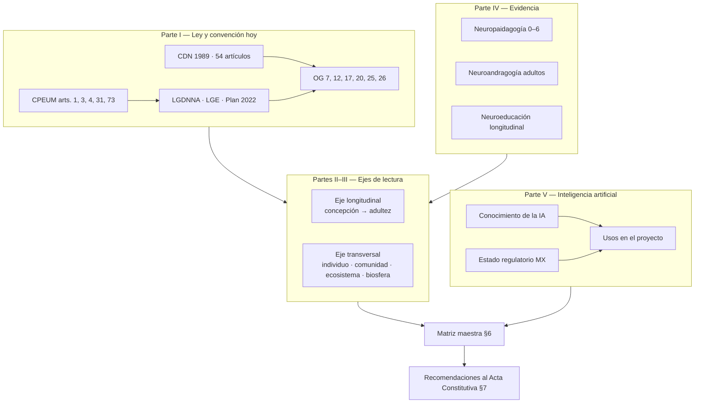

# Análisis transversal: Marco Constitucional, Convención sobre los Derechos del Niño, Neuroeducación e Inteligencia Artificial

## Cómo están planteadas hoy las leyes y convenciones, y su contraste con la ciencia del desarrollo, la neuropaidagogía, la neuroandragogía y el conocimiento de la IA — en lectura longitudinal y transversal

*Documento de trabajo · Serie documental del proyecto (5.º documento) · Complementa: `neuroeducacion-preescolar-3-6-informe.md` · `analisis-programa-sintetico-integracion-neuroeducacion.md` · `estres-crisis-calma-y-entornos-seguros-3-6.md` · `glosario-neuroeducativo.md` · `glosario-interseccionalidades-y-aparatos-ideologicos.md` · Fecha: 26 de septiembre de 2026*

---

## 0. Preámbulo: alcance, principios y trazabilidad

**Objetivo doble:**
1. **Entender cómo están planteadas hoy** las leyes y convenciones (pirámide jurídica mexicana + Convención sobre los Derechos del Niño, CDN).
2. **Contrastarlas** con los avances más actuales de la neuroeducación, la neuropaidagogía y la neuroandragogía —en lectura **longitudinal** (el tiempo del desarrollo) y **transversal** (el espesor del bienestar: individuo, comunidad, ecosistemas, biosfera)— y con lo que la **inteligencia artificial** aporta (y no aporta) sobre la realidad material humana y las necesidades holísticas.

**Principios del documento:**

| # | Principio |
|---|---|
| **T1** | **Vigencia verificada**: se distingue siempre entre *vigente*, *reforma reciente* e *iniciativa en discusión* (especialmente en materia de IA). |
| **T2** | **Sin sustituciones**: la ciencia no reemplaza a la norma ni la norma a la ciencia; donde coinciden se refuerzan y donde divergen se señala la brecha. |
| **T3** | **El derecho es el marco, la evidencia es el método**: todo lo que el proyecto haga debe caber simultáneamente en CDN/CPEUM *y* en la mejor evidencia disponible. |
| **T4** | **La IA es infraestructura adulta, no sustituto del adulto**: sirve a quienes cuidan y deciden; nunca reemplaza la relación serve and return [GN A19] ni decide por un niño. |

**Nivel fundacional (Segunda Tanda)**: sobre T1–T4 operan los **axiomas AX-1..3** (toda información es útil · los niños son resultado de los adultos y la realidad material · resignificación). Son el fundamento del aprendizaje andragógico y paidagógico del proyecto; fuente canónica: `fundamentos-axiomas-del-programa.md` (verbatim: `Primera Tanda/basesconceptuales.md`).

**Etiquetas de trazabilidad de la serie:** [GN] glosario neuroeducativo · [GI] glosario de interseccionalidades · [I1][I2][I3] informes · [PE] Plan de Estudio 2022/SEP · [ALT] Althusser · (autor, año) fuente externa en Referencias.

**Lectura mínima por rol:** *Sponsors/directivos*: §1, §4, §5, §7 · *Profesores*: §1, §2, §3, §4, §6 · *Familias*: §0, §1 (tabla), §4.2, §6.5 · *Todos (arranque)*: §0 + §7.

### Mapa transversal del documento

---

## 1. Parte I — Cómo están planteadas hoy las leyes y convenciones

### 1.1 Pirámide jurídica del proyecto (de la norma suprema al aula)

| Nivel | Instrumento | Qué fija para este proyecto | Vigencia verificada |
|---|---|---|---|
| **1. Constitución** | **CPEUM art. 1**: prohibición de discriminación por cualquier motivo | Umbral de no discriminación (C21 [GI]) | Vigente |
| | **CPEUM art. 3**: derecho a la educación; educación inicial/preescolar/primaria/secundaria = educación básica; **"la educación inicial es un derecho de la niñez"**; rectoría del Estado; educación **universal, inclusiva, pública, gratuita y laica**; enfoque de derechos humanos e igualdad sustantiva; formación docente con evaluación diagnóstica; el Ejecutivo Federal determina principios y planes **considerando la opinión de los gobiernos** | Base del Plan 2022 y del Acuerdo de Programas Sintéticos | Reforma **DOF 15-05-2019** (texto vigente, verificado) |
| | **CPEUM art. 4**: interés superior de la niñez como principio **rector de todas las decisiones y actuaciones del Estado**; necesidades de alimentación, salud, **educación y sano esparcimiento**; guía diseño, ejecución, seguimiento y evaluación de políticas públicas | Obliga a todo el proyecto (§7.1) | Elevado en **2011** (DOF 12-10-2011); primer párrafo reformado en materia de igualdad sustantiva **DOF 15-11-2024** |
| | **CPEUM art. 31**: obligación escolar y deber de los progenitores | Corresponsabilidad familia–escuela | Vigente |
| | **CPEUM art. 73 fr. XXIX-P**: facultad del Congreso para legislar en derechos de niñas, niños y adolescentes | Fundamento de la LGDNNA | Adicionada en **2011** |
| **2. Tratado internacional** | **Convención sobre los Derechos del Niño (CDN, 1989)** — 54 artículos, 196 Estados parte; **México ratificó en 1990** | Marco superior de interpretación (§1.2) | Vigente; se encuentra en revisión una **reforma del OP2** (discutida en 2024–2025) — verificar estado al firmar el Acta |
| **3. Leyes federales** | **LGDNNA** (2014): catálogo de derechos, principios rectores (interés superior; universalidad, interdependencia, indivisibilidad, progresividad, integralidad); niñas/niños <12 años; **art. 101 Bis 3: acceso a Internet libre de violencia** (adicionado DOF 24-12-2024) | Clasificación de edad, catálogo, protección digital | **Última reforma DOF 15-01-2026** |
| | **LGE** (2019): reglamentaria de la reforma de 2019; art. 14 (escuela y comunidad), arts. 29–30 (formación general y contenidos); "la educación inicial es un derecho de la niñez" (arts. 6, 37, 38) | Ampara contextualización y comunidad | Vigente |
| **4. Norma curricular** | **Plan de Estudio 2022** + **Acuerdo 08/08/23 (DOF 15-08-2023)** que establece los **Programas Sintéticos de las Fases 2 a 6** | **Este es el fundamento legal directo del documento fuente del proyecto** | Vigente |
| **5. Agenda internacional** | **ODS/Agenda 2030** (3, 4, 10, 13, 15, 16) | Marco de metas y de cooperación | Vigente a 2030 |

### 1.2 La Convención sobre los Derechos del Niño (CDN): estructura vigente

**Los 4 principios generales** (transversales a todo el texto; GC 5):

| Art. | Principio | Traducción operativa en el proyecto |
|---|---|---|
| **2** | **No discriminación** | Diseñar para todos desde el inicio; lente interseccional [GI A1] |
| **3** | **Interés superior del niño** | Toda decisión documenta cómo favorece al niño (T3) |
| **6** | **Vida, supervivencia y **desarrollo** integral** | Neurodesarrollo: cuerpo, emoción, cognición, cultura (§3) |
| **12** | **Derecho a ser escuchado** — expresar opiniones y que se les dé peso según edad y madurez | Participación infantil: círculos de diálogo, elecciones reales [GN D12] |

**Mecanismo transversal clave — art. 5, capacidades evolutivas:** los derechos se ejercen "en la medida de la **madurez**" del niño, con apoyo progresivo. **Este artículo es el puente legal ↔ neurociencia**: la madurez que la ley invoca es, biológicamente, la maduración de funciones ejecutivas y corteza prefrontal [GN A11–A15].

**Derechos agrupados por bloques:**

| Bloque | Artículos representativos | Puente neuro/educativo |
|---|---|---|
| **Supervivencia y desarrollo** | 6 (desarrollo), 24 (salud), 27 (nivel de vida), 28–29 (educación y **fines de la educación**), 31 (descanso, juego, ocio) | Sueño, alimentación, juego, vínculo — §3 |
| **Protección** | 19 (violencia), 22 (refugiados), 23 (discapacidad), 32 (explotación), 33–36 (abuso) | Estrés tóxico, ajustes razonables [I3], neurodiversidad [GN F] |
| **Participación** | 12 (ser escuchado), 13 (expresión), 15 (asociación), 17 (acceso a información), 30 (minorías e indígenas) | Diálogo, lenguaje, interculturalidad [GI C8] |

**Artículo 29 (fines de la educación)** — el más importante para este proyecto: la educación debe desarrollar la **personalidad, talentos y aptitudes** del niño "hasta el máximo de sus potencialidades"; fomentar el respeto a los **derechos humanos**, a la familia, a la **identidad cultural y las lenguas**; preparar para la **vida en sociedad libre, comprensión, paz, tolerancia, igualdad** y respeto al **medio ambiente natural**. ← Este artículo ya contiene, en 1989, la síntesis holística (individuo + sociedad + biosfera) que hoy reclaman la neuroeducación y la ciencia del cambio climático.

**Observaciones Generales (interpretación vigente del Comité):**

| OG | Año | Contenido | Relevancia aquí |
|---|---|---|---|
| **OG 7** | 2005 | Derechos del niño en la **primera infancia (0–8)** | Base de la mirada 0–6 |
| **OG 12** | 2009 | **Derecho a ser escuchado** | Participación en el aula |
| **OG 17** | 2013 | **Derecho al juego** | Juego como derecho, no como relleno [I1 §6.4] |
| **OG 20** | 2016 | Adolescencia y **capacidades evolutivas** | Cierre longitudinal (§2) |
| **OG 25** | 2021 | Derechos en el **entorno digital**: incluye explícitamente **inteligencia artificial, robótica, algoritmos, analítica de datos y biometría**; prohíbe perfilar a niños con fines comerciales; consultó a 709 niños | Marco de la Parte V |
| **OG 26** | 2023 | Derechos del niño y **medio ambiente**, con foco en cambio climático: **derecho a un ambiente limpio, sano y sostenible**; crisis planetaria triple (clima, biodiversidad, contaminación); 16,331 aportes de niños de 121 países | Marco del eje biosférico (§3.3) |

### 1.3 Síntesis: qué exige el marco al proyecto (en una sola lectura)

> El marco vigente exige: **(a)** educación inicial/preescolar como **derecho** (art. 3), **(b)** decisiones guiadas por el **interés superior** (art. 4), **(c)** los **4 principios** de la CDN (no discriminación, interés superior, desarrollo, ser escuchado), **(d)** **juego** y **participación** como derechos (arts. 31 y 12 + OG 17 y 12), **(e)** **inclusión** y no discriminación (art. 1 + art. 2 CDN), **(f)** protección **digital** de menores (LGDNNA art. 101 Bis 3 + OG 25), **(g)** responsabilidad **ambiental** (OG 26), **(h)** **formación docente** como obligación constitucional (art. 3).

---

## 2. Parte II — Eje longitudinal: el desarrollo como secuencia (neuroeducación a lo largo de la vida)

La ley habla de "capacidades evolutivas" y de "desarrollo integral"; la ciencia da la **línea de tiempo** que las hace concretas.

### 2.1 Línea de tiempo longitudinal (concepción → adultez)

| Etapa | Neuro (lo que madura) | Derecho-hito (CDN/MX) | Pedagogía correspondiente | Documento de la serie |
|---|---|---|---|---|
| **Concepción–0 años** | Neurulación, sinapsis masiva, estrés materno | Art. 6 CDN; art. 4 salud | Cuidado prenatal, apego temprano | [I1 §3] |
| **0–3 (Inicial, Fase 1)** | Pico de sinaptogénesis; lenguaje; poda temprana | Art. 3 MX "inicial es derecho de la niñez"; **OG 7** | Serve and return, juego sensorial, vínculo | [I1 §3.2] |
| **3–6 (Preescolar, Fase 2 — PROYECTO)** | Pico sinaptogénesis prefrontal ≈**3,5 años**; EF (inhibición → memoria → flexibilidad); teoría de la mente 3–5; etapa preoperacional | Art. 3 (preescolar básico); arts. 12, 31 CDN; **OG 17** | Juego, andamiaje, co-regulación, ambiente preparado | [I1], [I2], [I3] |
| **6–12 (Primaria)** | Mielinización extensa; consolidación EF; pensamiento concreto → operaciones formales tardías | Arts. 28–29 CDN | Transición a lógica; proyectos | — |
| **12–18 (Adolescencia)** | **Re-modelado prefrontal**; sistema de recompensa madura antes que el freno; ímpetu de autonomía | **OG 20**; capacidades evolutivas máximas | Acompañamiento, no imposición | — |
| **18–25+ (Adultez temprana)** | Corteza prefrontal madura a mediados–finales de los 20 (NIMH; Hardy et al., 2023) | Sujeto de pleno derecho | **Neuroandragogía** (§4.4) | [GN G] |

**Clave longitudinal:** el estándar adulto de inteligencia y criticidad ([I1 §2]) es la **meta del recorrido**, no la exigencia de la etapa 3–6. La ley lo dice como "capacidades evolutivas"; la neurociencia lo dice como "maduración prefrontal"; el proyecto lo traduce como **precursores, no como rendimiento**.

### 2.2 Evidencia longitudinal (estudios de seguimiento que sostienen la inversión temprana)

| Estudio | Qué mostró (a largo plazo) | Lectura para el proyecto |
|---|---|---|
| **Perry Preschool Project** (EE.UU., 1962–1965, seguimiento hasta adultez) | Más educación, empleo y menores embestidas en adultos que recibieron intervención temprana de calidad | Inversión en 0–6 **paga décadas después** |
| **Abecedarian** (Carolina, 1970s) | Mejores resultados cognitivos y de salud en seguimiento largo con educación temprana intensiva | Calidad y consistencia del cuidado importan |
| **ACEs (Felitti et al., 1998)** | La exposición acumulada a adversidad en la infancia se asocia con enfermedad y muerte prematura en adultez | El **estrés tóxico temprano** es un riesgo de salud pública — argumento para art. 4 y §5.2 de [I3] |
| **Dunedin (Nueva Zelanda, 1972–)** | Las funciones ejecutivas tempranas predicen resultados a los 38 años | Las EF de 3–6 son **predictores vitales** |
| **Meta-análisis de programas de primera infancia** | Efectos positivos cuando hay **calidad, duración y familia involucrada**; efectos se atenúan si el entorno tóxico persiste | Ninguna actividad salva a un niño de un entorno hostil: el **adulto** es la palanca [GN G22] |

### 2.3 Lo que la longitudinalidad exige a la política (y al proyecto)

1. **No fragmentar**: el niño de 3–6 no es una isla; el proyecto debe registrar **continuidad** (fichas/registros por grado) para que primaria reciba un suelo, no un reinicio.
2. **Medir a largo plazo**: KPIs de proceso hoy (§7) + indicadores de legado (qué hereda el ciclo siguiente).
3. **Priorizar por ventana**: en 3–6, las inversiones de mayor retorno son EF, lenguaje, vínculo y regulación ([I1 §3.4]).

---

## 3. Parte III — Eje transversal: holismo en cuatro capas (individuo → biosfera)

### 3.1 Las cuatro capas de la necesidad holística

| Capa | Qué incluye | Marco legal | Marco científico | Puente del proyecto |
|---|---|---|---|---|
| **1. Individuo** | Cuerpo, emoción, cognición, identidad, lenguaje | CDN arts. 6, 12, 24, 29 | Neurodesarrollo, EF, apego | [I1], [I3] |
| **2. Agrupaciones y comunidades** | Familia, aula, barrio, pueblos, culturas | CDN arts. 5 (familia), 15, 30; LGE art. 14; NEM "comunidad como núcleo" [GI C15] | Ecosistemas de apego; interculturalidad; capital cultural | [GI C15, A16] |
| **3. Ecosistemas sociales y naturales** | Escuela, salud, justicia, ambiente local, clima, biodiversidad | **OG 26 (2023)**: derecho a ambiente limpio, sano y sostenible; ODS 13/15 | Estrés por desastres, contaminación y neurodesarrollo; Ainsworth/Bronfenbrenner | §3.3 |
| **4. Realidad biosférica** | Límites planetarios, ciclos biogeoquímicos, intergeneracionalidad | OG 26 (obligaciones hacia **generaciones futuras**); CDN art. 29 ("respeto al medio ambiente natural") | Salud planetaria; el cerebro es sistema abierto al ecosistema | §3.3 |

### 3.2 El holismo ya está en la ley (aunque rara vez se lea así)

- **CDN art. 29** ya es holista: niño + familia + cultura + sociedad + naturaleza en un solo artículo.
- **CPEUM art. 4** ("alimentación, salud, educación y sano esparcimiento") es un **modelo bio-psico-social** escrito en norma suprema.
- **NEM/Plan 2022** operacionaliza: comunidad, vida saludable, interculturalidad, artes, pensamiento crítico [GI C3–C12].
- **Conclusión (T2)**: la ley **no está atrás** en su formulación; la brecha está en la **implementación y en la medición** — ahí es donde ciencia y proyecto entran.

### 3.3 La capa biosférica: el hallazgo más reciente y el menos traducido al aula

- **OG 26 (2023)**: primera vez que el Comité reconoce explícitamente el **derecho de los niños a un ambiente limpio, sano y sostenible** y declara que la crisis climática es una **crisis de derechos de la infancia**; obliga a los Estados a proteger no solo del daño actual sino del **previsible** (responsabilidad intergeneracional).
- **Ciencia**: la neurociencia del desarrollo aún es mayormente "de interiores"; el frente abierto es la **neuroecología del desarrollo** (cómo contaminación, calor, desastres y desigualdad ambiental alteran sueño, atención y regulación). *Esto es una brecha declarada de la ciencia, no un consenso cerrado — se marca como tal.*
- **Traducción al proyecto (nivel preescolar, sin dramatismos)**: naturaleza cotidiana, aire y juego exterior, cuidado de plantas/animales, vocabulario de clima, rutinas de calor/tormenta [I3 §2.8], y materiales que no ejemplifiquen consumismo.

---

## 4. Parte IV — Contraste: ley ↔ neuroeducación ↔ neuropaidagogía ↔ neuroandragogía

### 4.1 Armonías (donde la ley y la ciencia dicen lo mismo — confirmaciones mutuas)

| La ley dice | La ciencia confirma | Implicación práctica |
|---|---|---|
| CDN art. 19 + LGDNNA: **prohibido castigo corporal y tratos humillantes** | El castigo y la humillación producen **estrés tóxico** que altera arquitectura cerebral y deteriora EF (Harvard; NSCDC) | Protocolo de crisis sin castigo [I3 §6] |
| CDN art. 12 + OG 12: **ser escuchado** | El diálogo y la pregunta son los **mediadores del pensamiento crítico** en primera infancia (O'Reilly et al., 2022) | Círculos de diálogo y preguntas de orden superior [I1 §6.3] |
| CDN art. 31 + OG 17: **juego como derecho** | El juego construye EF, lenguaje, sociabilidad (AAP, 2018) | Juego libre ≥ núcleo de la jornada [I1 §6.4] |
| CDN art. 5: **capacidades evolutivas** | Maduración prefrontal / EF por etapas (Diamond; Hardy et al., 2023) | Precursores, no rendimiento adulto [I1 §2.4] |
| CDN art. 2 / CPEUM art. 1: **no discriminación** | Neurodiversidad y ajustes: mismo objetivo, distintas rutas (DUA) [GN F14, GI E8] | Ajustes razonables desde el diseño |
| CPEUM art. 3: **educación inicial es derecho** | Primeros años = máxima plasticidad; eficiencia de la inversión temprana (§2.2) | Prioridad presupuestal y de política |
| CPEUM art. 3: formación docente con diagnóstico | Formación docente **basada en evidencia y con aprendizaje activo** rinde (Dubinsky, 2019) | CTE con práctica deliberada [GN G20] |
| CPEUM art. 4: **interés superior** | "Interés superior" operacionalizado = **lo que la evidencia sabe que beneficia** (no lo que la moda eduque) | T3: toda decisión cita norma **y** evidencia |

### 4.2 Brechas: la ciencia va **adelante** de la norma (o la norma no la ha traducido)

| # | Brecha | Evidencia | Qué proponer (sin legislar desde el aula) |
|---|---|---|---|
| B1 | **Sueño, movimiento y alimentación no aparecen como condiciones del derecho a la educación** | Sueño insuficiente deteriora EF y conducta (CDC; PMC5529275); hambre/fatiga degradan atención | Incluirlos en la lectura de realidad (E2 [GN]) como **variables de derecho** |
| B2 | **Funciones ejecutivas no nombradas en norma ni currículo** | Son el predictor de éxito escolar y vital más robusto | Aparecer como *contenidos nuevos* (contextualización, [GN H12]) |
| B3 | **Salud mental docente no regulada** | El adulto desregulado aumenta la desregulación infantil (FPG) | Gobernanza: apoyo y rotación (§7.6) |
| B4 | **Neurodiversidad vs. modelo legal de "discapacidad"** | La ley habla discapacidad; la ciencia de perfiles habla de **diferencias neurodivergentes** con y sin diagnóstico | En el proyecto: lenguaje neuroafirmante [GN F11] dentro del marco legal vigente |
| B5 | **Identificación temprana**: la ley no fija edad ni método de tamizaje en preescolar | Hitos CDC permiten detectar señales a 3, 4 y 5 años | Protocolo de detección + derivación (no diagnóstico) [I1 §7] |
| B6 | **Estrés tóxico y ACEs invisibles en la escuela** | Felitti 1998; Harvard | Lectura de realidad con variable "adversidad del hogar" con mirada de apoyo, no de etiqueta |
| B7 | **Datos biométricos y emocionales de niños**: la OG 25 los menciona, la legislación mexicana aún no los regula específicamente | Vigilancia facial/emocional en aulas = riesgo | **Prohibición interna del proyecto** (§6.5) |

### 4.3 Brechas: la norma va **adelante** de la práctica (o de la ciencia aplicada)

| # | Brecha | Comentario |
|---|---|---|
| N1 | La ley dice **"juego"** (art. 31, OG 17) y muchas escuelas lo recortan por presión académica | La ciencia respalda a la ley; el problema es la **práctica**, no el marco |
| N2 | La ley dice **"ser escuchado"** (art. 12) y el aula suele ser adultocéntrica | La neuropaidagogía da el método (diálogo, participación real) |
| N3 | **OG 26 (2023)** es más reciente que la mayoría de las formaciones docentes | Pocas formaciones han traducido la OG 26 a preescolar: **brecha de capacitación** |
| N4 | La ley prohíbe el castigo físico y sigue siendo usado | Neuro + derecho coinciden; falta herramienta (protocolo, no discurso) |

### 4.4 Neuroandragogía: la ley obliga a los adultos — la ciencia dice cómo formarlos

La Constitución **obliga al Estado** (art. 4) y **exige formación docente** (art. 3); la CDN obliga a familias y profesores a actuar en interés del niño. **¿Cómo formar a esos adultos según la evidencia?** Aplicando el Bloque G del glosario neuroeducativo [GN G1–G26]:

| Obligación legal | Necesidad andragógica | Evidencia aplicable |
|---|---|---|
| Art. 3: formación docente "retroalimentada por evaluaciones diagnósticas" | Diagnóstico **de** capacidades adultas, no evaluación punitiva | Evaluación formativa de adultos; seguridad psicológica [GN G25] |
| Art. 4: todos los actos del Estado en interés superior | Que docentes, directivos y familias **comprendan** el principio, no solo lo repitan | 6 principios de Knowles: **primero el porqué** (WIIFM) [GN G16] |
| Contextualización (LGE/Plan) | Autonomía profesional = decisión adulta informada | Autodirección, experiencia, problema real [GN G3–G7] |
| Cambio de práctica (de castigo a reparación, de exámenes a formativa) | **Transformación de creencias**, no solo de técnicas | Andragogía transformacional + doble bucle [GN G6, G10] |
| Sostener el cambio 5 años+ | Evitar burnout docente | Burnout como riesgo #1 [GN G15], G18 andamiaje profesional |

> **Síntesis del §4**: la ley fija el **qué** (derechos), la neurociencia explica el **por qué biológico**, la neuropaidagogía da el **cómo con niños**, la neuroandragogía da el **cómo con los adultos**. Un proyecto que ignore cualquiera de los cuatro es o ilegal, o ingenuo, o ineficaz.

**[AX-2]/[AX-3]**: la formación de esos adultos es, además, el espacio de **resignificación** —cada docente comprende su propia historia e infancia (AX-2) y la revisa con matices (AX-3); ese trabajo interior es condición de la andragogía transformacional [GN G6] y del doble bucle [GN G10] que el Acta debe amparar.

---

## 5. Parte V — La inteligencia artificial: qué sabe, qué entiende y qué propone

### 5.1 Qué "conocimiento" tiene la IA sobre la realidad material humana

| Afirmación cuidadosa | Detalle |
|---|---|
| **Qué es** | Un modelo estadístico que **comprime patrones** de enormes corpus textuales/audiovisivos: representa correlaciones del lenguaje y la cultura humana a escala sin precedentes. |
| **Qué hace bien** | Sintetizar normas, cruzar marcos, traducir y ampliar acceso, detectar patrones en datos longitudinales, personalizar apoyos, generar materiales y auditarlos. |
| **Qué NO tiene** | **Cuerpo, experiencia vivida, emociones, intencionalidad ni conciencia**; no "comprende" el sufrimiento de un niño: lo describe estadísticamente. Su conocimiento es **derivado**, no experiencial. |
| **Límites documentados** | **Alucinación** (afirmar falsedades con confianza), **sesgo** (reproduce desigualdades de sus datos de entrenamiento), **opacidad** (no siempre explica sus inferencias), **dependencia de datos** (sesgo por falta de datos de poblaciones minoritarias). |
| **Costo material** | Entrenamiento e inferencia consumen **energía y agua**: la propia IA tiene huella biosférica — coherencia exige incluirla en el eje del §3.3 (OG 26). |

**Lectura para el proyecto (T4):** la IA es el mejor **sintetizador y espejo** disponible; es el peor **juez y cuidador**. Sabe *sobre* los niños; no sabe *con* los niños.

**[AX-2]**: la IA es el contrapunto perfecto del axioma — *no ha tenido infancia, ni cuerpo, ni realidad material directa*; por eso su conocimiento de las necesidades holísticas es derivado y delegable, nunca equivalente al del adulto que ha vivido.

### 5.2 Lo que la IA aporta sobre necesidades holísticas (individuo, comunidad, ecosistemas, biosfera)

| Capa | Aporte concreto de la IA | Límite |
|---|---|---|
| **Individuo** | Detección temprana de patrones de riesgo en datos de desarrollo (asistencia, lenguaje, sueño reportado); apoyos personalizados de aprendizaje; AAC y accesibilidad (voz, pictogramas, traducción) | Nunca diagnóstico automatizado; nunca perfilado emocional de un niño sin consentimiento y supervisión humana |
| **Comunidad** | Análisis de cohesión, servicios, brechas de cobertura; traducción para familias bilingües; tableros de seguimiento del Programa Analítico | Datos comunitales pueden estigmatizar si no se anonimizan |
| **Ecosistemas sociales y naturales** | Modelos predictivos de riesgo climático/sanitario local; calidad del aire y su impacto reportado; optimización energética de planteles | La IA modela; **la decisión política es humana** |
| **Biosfera** | IPCC/IPBES y modelos terrestres = "IA al servicio de la Tierra"; monitoreo de biodiversidad; cálculo de ODS | La IA que hoy entrena modelos climáticos también consume recursos: **coherencia > eficiencia** |

**Propuesta de IA sobre el "bienestar holístico"** (síntesis de la evidencia disponible, verificable por los humanos del proyecto): el bienestar de un niño es **bio-psico-social-espiritual-encontexto**; ningún indicador aislado lo capta; por eso la IA debe operar **multi-indicador y desagregado** [GN E19], nunca como score único de "desempeño infantil".

### 5.3 Estado del marco regulatorio de la IA en México (verificado a septiembre 2026)

| Fecha | Hecho | Estado |
|---|---|---|
| 2023–2026 | **Sin ley federal de IA**: se han acumulado iniciativas desde 2023 sin aprobarse | **Vacío federal** |
| 2024–2026 | Varios **estados han legislado** (México, Sinaloa, Querétaro, Michoacán, Oaxaca, Jalisco, San Luis Potosí): riesgo de 32 regímenes heterogéneos (SCJN) | Vigente/parcial |
| **22-04-2025** | Iniciativa de **Ley Federal para el Desarrollo Ético, Soberano e Inclusivo de la IA**: semáforo de riesgos (mínimo/limitado/alto/**prohibido**); prohíbe vigilancia masiva sin orden, puntualización social coercitiva, manipulación psicológica extrema y **explotación de niñas/niños**; **evaluaciones de impacto específicas para infancia** y prohibición de perfilar/manipular emocionalmente a menores; Registro y Consejo Nacional de IA | **Iniciativa** |
| 2025 | Propuesta del **Senado**: **Ley General** para regular y fomentar la IA + plan nacional + leyes sectoriales (incluye **Ley General de Educación** como vertiente vertical) | En construcción (abril 2026) |
| 24-12-2024 | **LGDNNA art. 101 Bis 3**: derecho a acceso a **Internet libre de violencia** contra menores | **Vigente** |
| ene-2026 | Iniciativa para extender protección de datos personales a **sistemas de IA** (reforma LFPDPPP) | Iniciativa |
| **ago-2026** | Iniciativa de reforma al **art. 73 CPEUM** para facultar al Congreso a legislar la IA (evitar fragmentación estatal) | **Iniciativa** |
| Internacional | **OG 25 (CDN)**: derechos de niños en entorno digital **incluyen IA/algoritmos/biometría**; **UNICEF**: *Policy guidance on AI for children*; **UE AI Act (2024)**: sistemas educativos = alto riesgo; **UNESCO**: Recomendación sobre ética de la IA (2021) | Referentes |

> **Conclusión del §5.3**: el marco **proteccional** mexicano para niños + digital ya existe (CDN, LGDNNA, OG 25); el marco **de IA** está en construcción. El proyecto no puede esperar: aplica **por anticipado** los principios de los principales borradores (riesgo proporcional, transparencia, no perfilar menores, supervisión humana).

### 5.4 IA en el proyecto preescolar: usos aceptables y prohibidos

| **USOS ACEPTABLES** (con supervisión humana) | **USOS PROHIBIDOS** (prohibición interna del Acta) |
|---|---|
| Sintetizar y contrastar norma ↔ evidencia (como este documento) | **Perfilar o clasificar niños** por IA (emoción, atención, "riesgo") |
| Auditar materiales con checklist interseccional [GI E10] a escala | **Vigilancia biométrica o emocional** en el aula (cámaras, micrófonos que analicen caras/voz) |
| Apoyar al CTE: borradores de Programa Analítico, tableros KPI, desagregación de datos | **Decisiones evaluativas** sobre un niño tomadas o propuestas por IA |
| Traducción y accesibilidad (lenguas, AAC, lectura fácil) | Enviar **datos personales de niños** a servicios sin consentimiento ni anonimización |
| Retroalimentación a docentes sobre sus propias prácticas (agregado, anónimo) | **Sustituir al adulto**: apps que "enseñan" en lugar del juego y la relación |
| Detección de **brechas en datos del plantel** (ausentismo por grupo) | Generar contenidos pedagógicos **sin revisión humana** (alucinaciones) |
| Investigación agregada y anónima de mejora | Comercializar datos o perfiles de la comunidad escolar |

### 5.5 Los 6 principios de IA del proyecto (para el Acta Constitutiva)

1. **Supremacía humana** (T4): toda decisión con impacto en un niño la toma una persona identificable.
2. **Minimización de datos infantiles**: se recolecta lo mínimo; nunca biométricos ni emocionales.
3. **Transparencia**: cuando una herramienta de IA se use, se dice a familias y equipo **qué hace y qué no hace**.
4. **Proporcionalidad de riesgo** (semáforo de la iniciativa de 2025 como criterio voluntarily adopted).
5. **Coherencia biosférica**: preferir herramientas eficientes; no justificar derroche tecnológico en un proyecto de 3–6 (OG 26).
6. **No sustitución**: la IA **nunca** reemplaza serve and return, co-regulación ni el juego ([GN A19, C2]).

---

## 6. Parte VI — Matriz maestra de trazabilidad (ley × neuro × NEM × IA × proyecto)

| # | Derecho / norma | Fuente | Base neurocientífica | Eje/elemento NEM | Punto del proyecto | IA: rol aceptable |
|---|---|---|---|---|---|---|
| 1 | Interés superior de la niñez | CPEUM art. 4; CDN art. 3 | "Lo mejor según evidencia" (EBP) | Todo | Trazabilidad de decisiones [GN I15] | Sintetizar evidencia para decidir |
| 2 | No discriminación | CPEUM art. 1; CDN art. 2 | Neurodiversidad; DUA | Eje Inclusión | Ajustes razonables [GN F14] | Auditar materiales por sesgos |
| 3 | Desarrollo integral | CDN art. 6 | EF, apego, lenguaje | 4 Campos | Secuenciación espiral [GN E18] | Tableros multi-indicador |
| 4 | Ser escuchado | CDN art. 12; OG 12 | Pensamiento crítico (diálogo) | Eje Pensamiento crítico | Círculos de diálogo [I1 §6.3] | — |
| 5 | Juego y ocio | CDN art. 31; OG 17 | Juego → EF (AAP) | Artes/estética | Juego libre ≥ núcleo | Auditar carga académica |
| 6 | Educación de calidad | CPEUM art. 3; CDN 28–29 | Ventanas; ZDP | Plan 2022 | Programa Analítico | Apoyo a docentes |
| 7 | Salud y condiciones | CPEUM art. 4; CDN 24 | Sueño/hambre/estrés | Vida saludable | Lectura de realidad (+sueño) [GN E19] | — |
| 8 | Participación progresiva (capacidades evolutivas) | CDN art. 5 | Maduración prefrontal | Perfil de egreso | Precursores no rendimiento | — |
| 9 | Inclusión y discapacidad | CDN 23; LGDNNA | Neurodiversidad, ajustes | Eje Inclusión | DUA [GI E8] | AAC, accesibilidad |
| 10 | Lenguas y cultura | CDN 30; CPEUM art. 2 | Lenguaje = ventana temprana | Eje Interculturalidad crítica | Saberes comunitarios [GI E15] | Traducción/inclusión |
| 11 | Protección digital | LGDNNA 101 Bis 3; **OG 25** | Atención/pantallas (AAP) | Vida saludable | Criterios de pantalla [I1 §5.3] | **Prohibición de perfilar** (§6.5) |
| 12 | Ambiente limpio y sano | **OG 26 (2023)**; CDN 29 | Neuroecología (brecha abierta) | Vida saludable | Naturaleza cotidiana (§3.3) | Monitoreo ambiental agregado |
| 13 | Formación docente | CPEUM art. 3 | Neuroandragogía [GN G] | CTE | Acompañamiento, no charla | Apoyo al CTE con revisión humana |
| 14 | Crianza sin violencia | LGDNNA; CDN 19 | Estrés tóxico (Harvard) | — | Protocolo de crisis [I3 §6] | — |
| 15 | Comunidad como núcleo | LGE art. 14; NEM | Ecosistemas de apego | Comunidad | Familia y saberes | Tableros comunitarios anónimos |

---

## 7. Parte VII — Recomendaciones para el Acta Constitutiva (síntesis accionable)

| # | Recomendación | Fuente legal | Fuente científica |
|---|---|---|---|
| **R1** | Insertar en el Acta el **art. 4 CPEUM** y los **4 principios de la CDN** como criterio de decisión de primer nivel (todo acta, todo Analítico, todo protocolo). | CPEUM 4; CDN 2, 3, 6, 12 | T3 |
| **R2** | Declarar **juego, descanso y participación** como derechos operativos del horario (no como recompensa). | CDN 31, 12; OG 17, 12 | AAP 2018; O'Reilly 2022 |
| **R3** | Añadir a la **lectura de realidad** las variables: sueño, alimentación, adversidad del hogar, lengua, condiciones materiales — con mirada de **apoyo**, no de etiqueta. | CPEUM 4; CDN 24 | [I3 §2.1]; ACEs |
| **R4** | Formalizar el **protocolo de detección y derivación** por edad (3/4/5) sin diagnóstico en el aula. | LGE/LGDNNA salud | CDC milestones [I1 §7] |
| **R5** | Adoptar los **6 principios de IA** (§5.5) como política interna, **mientras no exista ley federal**; revisar cada semestre el estado legislativo (iniciativas 2025–2026). | OG 25; LGDNNA 101 Bis 3; borradores MX | T4 |
| **R6** | Formación docente obligatoria en **neurodesarrollo 3–6 + neuroandragogía**, con formato de andamiaje (no charla única), evaluada por **seguridad psicológica**. | CPEUM 3 (formación) | [GN G]; Dubinsky 2019 |
| **R7** | Incorporar **OG 26** en el currículo de aula: naturaleza cotidiana, vocabulario ambiental, cuidado local (sin catastrofismo). | OG 26 | §3.3 |
| **R8** | Gobernanza de datos: **nunca biométricos ni emocionales** de niños; consentimiento informado de familias para cualquier herramienta digital. | OG 25; LGDNNA | §6.5 |
| **R9** | Medir **desagregado** (equidad [GI E19]) y con **línea base** (PM [GN I13]); indicadores por las cuatro capas (individuo, comunidad, ecosistema, biosfera — §3.1). | CPEUM 4 (seguimiento) | §2.2 |
| **R10** | Revisión anual de **brechas B1–B7** (§4.2) en CTE: la ciencia avanza; el Acta debe poder actualizarse sin romperse. | LGE autonomía | T2 |
| **R11** | Incorporar los **axiomas AX-1..3** como preámbulo/fundamento del Acta Constitutiva (nivel fundacional sobre T1–T4), con su fuente canónica y guardas. | P3 del programa | AX-1..3 (`fundamentos-axiomas-del-programa.md`) |

### 7.1 Tensiones abiertas que el Acta debe reconocer (no ocultar)

1. **Vacío regulatorio de IA** mientras los datos infantiles crecen — el proyecto se autorregula por anticipado.
2. **Financiamiento y equidad**: sin recursos, el "interés superior" es letra muerta (ODS 4, 10).
3. **Formación docente insuficiente** en neurociencia y derechos (brecha N3).
4. **Presión académica prematura** vs. art. 31/OG 17: la tensión más viva del preescolar.
5. **Clima y ambiente**: la OG 26 exige traducir el derecho ambiental a rutinas de aula — campo casi virgen.
6. **Coherencia intra-sistema**: los AIE (familia, medios, escuela) no siempre coinciden [GI B17]: el Acta debe prever **diálogo, no confrontación**.

---

## Fundamentos transversales — Axiomas del programa (AX-1..3)

> *Capa transversal de la Segunda Tanda (integración híbrida). Fuente verbatim: `Primera Tanda/basesconceptuales.md`; fuente canónica: `fundamentos-axiomas-del-programa.md`.*

| Axioma | Texto (síntesis) | Dónde opera en este documento |
|---|---|---|
| **[AX-1]** | Toda información es útil; hacer da más información que no hacer. | §0 T2 (ciencia y norma se refuerzan: ambos son información), §7.1 (las tensiones declaradas son dato, no fracaso), R10 (revisar sin romperse) |
| **[AX-2]** | Los niños son el resultado de los adultos y la realidad material; el adulto es su historia. | §0 (nivel fundacional sobre T1–T4), §4.4 (formación y resignificación de los adultos), §5.1 (la IA no ha vivido: conocimiento derivado) |
| **[AX-3]** | La resignificación: matices, no binarismo; sus crisis nutren al individuo y su entorno. | §4.4 (resignificación como trabajo andragógico), §4.2–4.3 (brechas: ver la ley con matices), R11 (axiomas en el Acta) |

**Cierre longitudinal de la serie**: este documento era ya el eje longitudinal/transversal (niño → adulto → norma → biosfera); con AX-1..3 se le añade su **nivel fundacional filosófico**, que el Acta Constitutiva recogerá como preámbulo (R11).

---

## Referencias

### Serie documental
1. `glosario-neuroeducativo.md` [GN] · `glosario-interseccionalidades-y-aparatos-ideologicos.md` [GI] · `neuroeducacion-preescolar-3-6-informe.md` [I1] · `analisis-programa-sintetico-integracion-neuroeducacion.md` [I2] · `estres-crisis-calma-y-entornos-seguros-3-6.md` [I3].

### Marco jurídico mexicano (verificado a septiembre 2026)
2. CPEUM, arts. 1, 2, 3, 4, 31, 73. Reforma educativa **DOF 15-05-2019** (texto vigente del art. 3). https://www.dof.gob.mx/nota_detalle.php?codigo=5560457&fecha=15%2F05%2F2019
3. CPEUM art. 4 — interés superior de la niñez (Decreto 198, **DOF 12-10-2011**); reforma de igualdad sustantiva **DOF 15-11-2024**.
4. **LGDNNA** — texto vigente, **última reforma DOF 15-01-2026**; art. 101 Bis 3 (Internet libre de violencia, **DOF 24-12-2024**). http://www.diputados.gob.mx/LeyesBiblio/pdf/LGDNNA.pdf
5. **LGE** (2019), arts. 2, 6, 14, 29, 30, 37, 38.
6. SEP (2023). **Acuerdo 08/08/23, DOF 15-08-2023**: Programas de Estudio / **Programas Sintéticos de las Fases 2 a 6**.
7. SEP (2024). *Plan de Estudio para la Educación Preescolar, Primaria y Secundaria 2022* [PE].
8. Senado/Cámara (2025–2026). Iniciativas de ley de IA: *Ley Federal para el Desarrollo Ético, Soberano e Inclusivo de la IA* (22-04-2025); propuesta de **Ley General** y plan nacional (Senado, 04-2026); reforma al **art. 73 CPEUM** (08-2026); reforma LFPDPPP (01-2026). https://comunicacionsocial.diputados.gob.mx/ ; https://comunicacionsocial.senado.gob.mx/

### Convención sobre los Derechos del Niño
9. **CDN** (1989), 54 artículos; 196 Estados parte; México ratificó en 1990. OHCHR/UNICEF.
10. **OG 7** (2005) primera infancia · **OG 12** (2009) derecho a ser escuchado · **OG 17** (2013) juego · **OG 20** (2016) adolescencia y capacidades evolutivas.
11. **OG 25 (2021)** — entorno digital: incluye IA, robótica, algoritmos, biometría. CRC/C/GC/25. https://digitallibrary.un.org/record/3906061
12. **OG 26 (2023)** — derechos del niño y medio ambiente con foco en cambio climático. CRC/C/GC/26, 22-08-2023; 16,331 aportes de niños de 121 países. https://www.ohchr.org/en/documents/general-comments-and-recommendations/crccgc26-general-comment-no-26-2023-childrens-rights
13. UNICEF (2021). *Policy guidance on AI for children* (v2).

### Neurociencia, desarrollo y formación de adultos
14. Referencias completas de [I1], [I2], [I3] (Diamond 2013; Harvard/NSCDC; AAP/Yogman 2018; O'Reilly et al. 2022; CDC milestones; Hardy et al., 2023; NIMH).
15. Felitti, V. et al. (1998). ACEs. *American Journal of Preventive Medicine*, 14(4).
16. Shonkoff, J. et al. — *Perry Preschool*, *Abecedarian* y metaanálisis de primera infancia (reseñas en Harvard Center working papers).
17. Dubinsky, J. M. (2019). Contributions of Neuroscience Knowledge to Teachers. PMID 30895863.
18. Knowles, M. S. et al. — andragogía [GN G]; Chen & Goodwill (2023) neuroplasticidad adulta.

### Inteligencia artificial
19. OCDE — *AI Principles*. https://oecd.ai/en/ai-principles
20. UNESCO (2021). *Recommendation on the Ethics of Artificial Intelligence*.
21. Unión Europea (2024). *AI Act* — sistemas educativos clasificados como alto riesgo.
22. Limitaciones de LLM (alucinación, sesgo, opacidad): literatura de evaluación de modelos (p. ej. Bender & Koller 2020; NIST AI RMF 2023).

---

*Nota metodológica: hechos jurídicos verificados el 26 de septiembre de 2026. Las iniciativas sin aprobar se marcan explícitamente como tales (T1). Este documento no es asesoría jurídica ni sustituye el texto vigente de las normas; su función es trazabilidad para el Acta Constitutiva. Mantenimiento: revisión semestral en CTE (estado legislativo de IA y actualizaciones de Observaciones Generales).*
