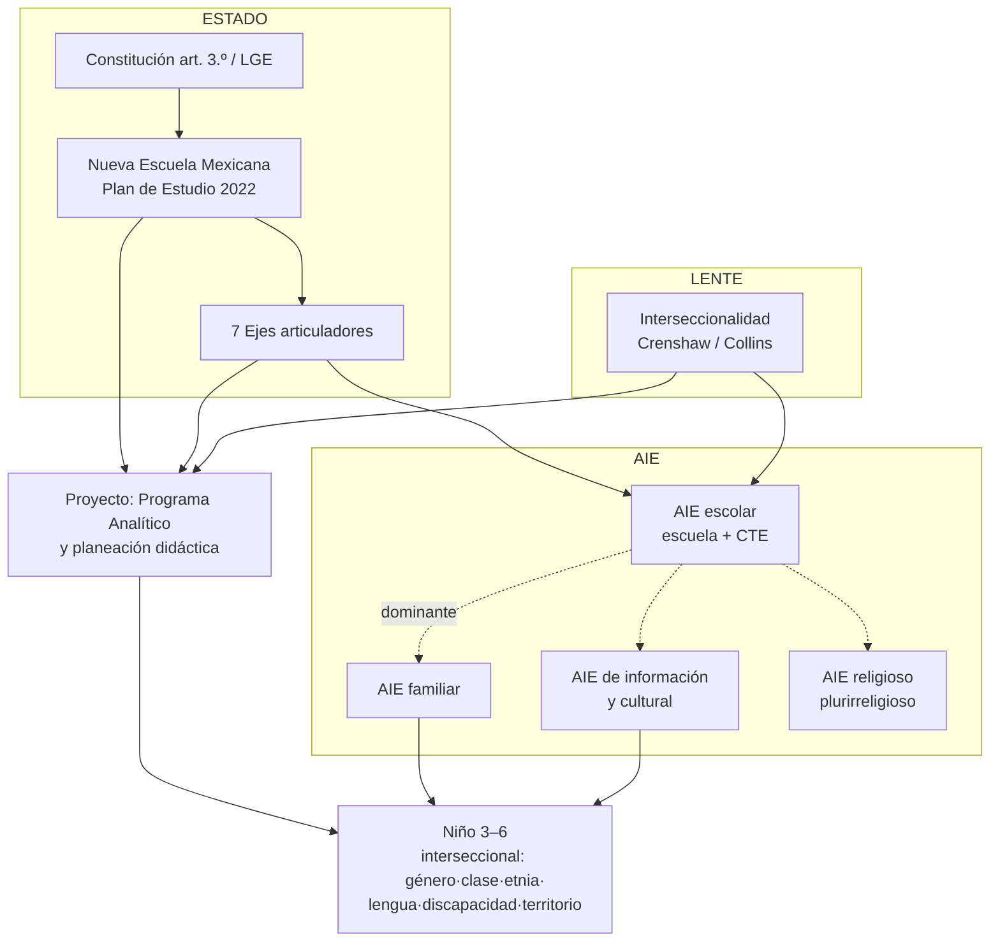

# Glosario de Interseccionalidades e Ideología

## Integración con las ideologías y los aparatos ideológicos del Estado

*Documento base previo al Acta Constitutiva · Compañero de `glosario-neuroeducativo.md` (doble vía: neuroeducación ↔ interseccionalidad/ideología) · Serie documental del proyecto · Fecha: 26 de septiembre de 2026*

---

## 0. Preámbulo: para qué sirve este glosario

**Propósito.** Que padres, tutores, profesores, aprendientes, estudiantes, directivos, sponsors, stakeholders y managers conozcan el **léxico con el que el Estado y la educación operan ideológicamente**, de modo que el Acta Constitutiva, la arquitectura curricular y cada decisión del proyecto sean **comprensibles, trazables, observables y aceptables** para todos.

**Contexto.** Toda escuela es, en términos de Althusser, un **aparato ideológico del Estado (AIE)**: ya opera dentro de una ideología, no fuera de ella. Este glosario no "agrega política al proyecto": **hace explícita la política que ya estaba** — la del Plan de Estudio 2022, la Nueva Escuela Mexicana (NEM) y el marco de derechos humanos— y la cruza con el **lente de interseccionalidad** para que ninguna decisión quede en zona opaca.

**Principios del glosario:**

| # | Principio |
|---|---|
| **P0** | **No hay neutralidad**: la escuela ya es AIE; el glosario no toma partido partidista, hace trazable el partido que ya se tomó (Plan 2022/NEM) y sus alternativas conceptuales. |
| **P1** | **Descriptivo, no adoctrinante**: definir una idea ≠ recomendarla como fe. El glosario distingue *qué dice cada marco* de *qué decide el proyecto*. |
| **P2** | **Interseccionalidad como lente, no como etiqueta**: sirve para mirar decisiones (nunca para estereotipar a un niño). |
| **P3** | **Horizonte de derechos**: la Convención sobre los Derechos del Niño y el marco constitucional mexicano priman sobre cualquier lectura particular. |

**Convenciones de trazabilidad:**

| Etiqueta | Significado |
|---|---|
| [GN] | `glosario-neuroeducativo.md` (término del glosario neuroeducativo, con su ID, p. ej. [GN F1] = neurodiversidad) |
| [I1] [I2] [I3] | Informes de la serie: neuroeducación · integración Programa Sintético · estrés/crisis/entornos |
| [PE] | Plan de Estudio 2022 / SEP |
| [ALT] | Althusser (1970) |
| (autor, año) | Fuente externa citada en Referencias |

**Lectura mínima por rol:**

| Rol | Bloques imprescindibles |
|---|---|
| Sponsors / directivos / managers | P0–P3, Mapa de integración, B, C, E, F |
| Profesores y tutores | A (básico), C, D, E, F + reglas de lenguaje |
| Familias | D, E, F + preámbulo + reglas de lenguaje |
| Estudiantes / aprendientes | A, D + mapa |
| Sesión de arranque (todos) | P0–P3 + Mapa de integración + reglas de lenguaje |

### Mapa de integración: cómo se cruzan interseccionalidad, aparatos e ideología del Estado

**Lectura del mapa:** el Estado imprime su ideología por el AIE escolar (Plan 2022 → ejes → Programa Analítico → aula); la familia y los medios son AIE paralelos que también educan; el lente de interseccionalidad atraviesa ambos para que el resultado **no reproduzca jerarquías** (clase, etnia, género, capacidad) que el propio Plan 2022 declara combatir.

---

## Bloque A — Interseccionalidad y teoría crítica

| ID | Término | Definición operativa | Base y uso en el proyecto |
|---|---|---|---|
| A1 | **Interseccionalidad** | Las categorías sociales (raza/etnia, género, clase, capacidad, edad, lengua…) **no actúan por separado**: se cruzan y producen experiencias de ventaja o desventaja **singulares**. | Crenshaw 1989 [Ref] |
| A2 | **Marco de eje único (single-axis)** | Analizar un problema con **una sola categoría** ("solo género", "solo pobreza") y perder la experiencia real. Es el error que la interseccionalidad corrige. | Crenshaw 1989 |
| A3 | **Matriz de dominación** | Conjunto interrelacionado de sistemas de opresión (racial, de clase, de género…) que opera a nivel estructural, disciplinario e interpersonal. | Collins 2000 [Ref] |
| A4 | **Subordinación interseccional** | La carga combinada de varias opresiones **no es la suma** de cada una: es una tercera condición distinta (p. ej. niña indígena con discapacidad). | Crenshaw 1991 |
| A5 | **Privilegio** | Ventaja estructural por pertenecer a categorías socialmente dominantes; invisible para quien lo posee. | [Ref] |
| A6 | **Sistemas de opresión / dominación** | Patrones estructurales que distribuyen poder y recursos por categoría social; la interseccionalidad los estudia **entrelazados**. | [Ref] |
| A7 | **Feminismo negro / epistemología feminista negra** | Tradición de pensamiento que produce conocimiento **desde** la experiencia interseccional; raíz teórica de A1. | Combahee 1977; Collins 2000 |
| A8 | **Posicionalidad** | Situación desde la que un adulto del proyecto mira: su lugar social condiciona lo que ve y lo que no ve. Se hace explícito en la lectura de la realidad (E2). Anclaje del axioma **[AX-2]**: el adulto es su historia e infancia materiales — de ahí que se declare, no se oculte. | [Ref] |
| A9 | **Esencialismo (identitario)** | Tratar una identidad como si definiera a la persona por completo. La interseccionalidad **lo rechaza**: las identidades son múltiples y cambiantes — el axioma **[AX-3]** lo expresa como exigencia de *matices* (ni rosa, ni negro, ni blanco). | [GN F1] |
| A10 | **Teoría crítica** | Corriente que estudia cómo las ideas y las instituciones **producen y mantienen** desigualdad, en lugar de darlas por naturales. Marco de lectura del glosario. | [Ref] |
| A11 | **Pedagogía crítica** | Educación que problematiza la realidad y forma sujetos capaces de transformarla, no de aceptarla. Relación con el eje "Pensamiento crítico" (C7). | Freire 1970 [Ref] |
| A12 | **Educación bancaria** | Modelo donde el docente "deposita" saber en un alumno vacío. Se practica cuando se transmite contenido sin problematizar. | Freire 1970 |
| A13 | **Educación problematizadora** | Contraparte: aprender interrogando la realidad. En preescolar: preguntas detonadoras, proyectos comunitarios [GN E9, GN E16]. | Freire 1970 |
| A14 | **Hegemonía** | Dominio que se sostiene **más por consenso que por fuerza**: se acepta como "sentido común" el orden que conviene a unos pocos. | Gramsci [Ref] |
| A15 | **Consenso (en Gramsci)** | Adhesión voluntaria de los gobernados al marco cultural dominante; función central de los AIE. | Gramsci/Althusser [ALT] |
| A16 | **Capital cultural** | Saberes, códigos y gustos que la escuela **valora y premia**; quienes no los traen de casa parten en desventaja. Explica parte de la brecha por clase. | Bourdieu [Ref] |
| A17 | **Habitus** | Internalización profunda de la posición social: "maneras de ser" que parecen naturales. Se reproduce en el aula sin que nadie lo decida. | Bourdieu [Ref] |
| A18 | **Violencia simbólica** | Imposición de significados como si fueran evidentes (el "obvio"), sin violencia física visible. | Bourdieu [Ref] |
| A19 | **Colonialidad del poder** | Herencia colonial que sigue organizando la sociedad por jerarquías de "raza"/etnia, incluso sin colonia formal. Clave para leer México. | Quijano 1992/2000 [Ref] |
| A20 | **Colonialidad del saber** | Jerarquía que ubica al saber europeo/occidental como único válido y subalterniza los demás. | Walsh 2007 [Ref] |
| A21 | **Eurocentrismo** | Mirada que toma la experiencia europea como medida universal; sesga materiales, ejemplos y "lo que se espera" de un niño. | Quijano [Ref] |
| A22 | **Interculturalidad crítica** | Diálogo entre culturas **que cuestiona las jerarquías de poder**; no se conforma con "mostrar diversidad". Eje articulador oficial (C8). | Walsh 2007; [PE] |
| A23 | **Multiculturalismo (crítico vs. liberal)** | Liberal: "respetar lo distinto" sin cambiar el orden (folclor). Crítico: redistribuir poder. **El proyecto practica el crítico.** | Walsh [Ref] |
| A24 | **Pedagogía descolonial** | Reordenar el aula para desactivar jerarquías de saber; incluye saberes comunitarios como conocimiento válido [GN E19]. | Walsh 2007 |
| A25 | **Epistemicidio / epistemologías del Sur** | Destrucción de formas de conocer no occidentales / recuperación de ellas. Se contrapone a A20. | Santos 2009 [Ref] |
| A26 | **Lenguaje no sexista / inclusivo** | Recurso lingüístico que no hace invisible a ningún género; exigencia de los documentos oficiales (p. ej. "las y los estudiantes"). | [PE]; reglas de lenguaje |
| A27 | **Ciudadanía crítica** | Sujeto capaz de leer críticamente su realidad y participar en lo común: meta declarada del Perfil de egreso (C13). | [PE] |

---

## Bloque B — Ideología y aparatos ideológicos del Estado (Althusser)

| ID | Término | Definición operativa | Base y uso en el proyecto |
|---|---|---|---|
| B1 | **Ideología** | Conjunto de representaciones que una sociedad da sobre sí misma y que **funciona como si fuera natural**; para Althusser, los individuos **viven** su relación con el mundo por la ideología. | Althusser 1970 [ALT] |
| B2 | **Ideología dominante** | La de la clase/grupo con poder; se realiza **a través de los AIE**, con contradicciones. En México, se materializa en currículo oficial (PE). | [ALT] |
| B3 | **Aparato ideológico del Estado (AIE)** | Instituciones (religiosa, escolar, familiar, jurídica, política, sindical, de información, cultural) que difunden ideología **por consenso**, no por fuerza. | [ALT] |
| B4 | **Aparato represivo del Estado (ARE/RSI)** | Gobierno, administración, ejército, policía, tribunales, prisiones: funcionan **masivamente por la represión** (con ideología secundaria). | [ALT] |
| B5 | **Diferencia ARE/AIE** | Ambos usan violencia e ideología, pero el ARE predomina la represión y el AIE **predomina la ideología**; los AIE pueden ser públicos o privados y aun así funcionar como tales. | [ALT] |
| B6 | **AIE escolar** | El sistema de escuelas públicas y privadas; **AIE dominante** en el capitalismo moderno (junto con la familia: "la pareja escuela-familia"). Aquí ocurre este proyecto. | [ALT]; Rubilar 2015 [Ref] |
| B7 | **AIE familiar** | La familia como aparato que transmite normas, lenguaje y jerarquías antes y después de la escuela; **aliado y contrapeso** del AIE escolar. | [ALT] |
| B8 | **AIE de información y cultural** | Prensa, radio, TV, plataformas, literatura, artes, deportes: producen sentido cotidiano fuera de la escuela (hoy: redes y algoritmos). | [ALT] |
| B9 | **AIE religioso / jurídico / político / sindical** | Las iglesias (en México, Estado laico y diversidad religiosa), el derecho, los partidos y los sindicatos como canales ideológicos. | [ALT]; C14 |
| B10 | **Interpolación / interpelación** | El mecanismo por el cual la ideología "llama" al individuo (como un policía: "¡Hey, usted ahí!") y este **responde y se reconoce** sujeto. | [ALT] |
| B11 | **Sujeto ideológico** | Quien, al responder a la interpolación, **se reconoce** como sujeto y **obedece libremente**; el "obedecer porque es correcto" que la escuela entrena. | [ALT] |
| B12 | **Ideología sin historia** | Tesis: la ideología no tiene historia propia (a diferencia de la ciencia); su forma general es constante aunque cambie su contenido. | [ALT] |
| B13 | **Reproducción de las condiciones de producción** | Función fundamental de los AIE: reproducir **no solo técnicas** sino la sumisión al orden establecido y la ideología dominante. | [ALT] |
| B14 | **Reproducción de relaciones sociales** | La escuela reproduce (aunque con tensiones) las relaciones de clase, etnia, género y poder de la sociedad; **interrumpir esa reproducción** es el trabajo interseccional (bloque D–E). | [ALT]; A1 |
| B15 | **Falsa evidencia / obediencia voluntaria** | Apariencia de que el orden es "natural y de todos"; el consenso sustituye a la fuerza. | [ALT]; Gramsci |
| B16 | **Neutralidad ideológica (de la escuela)** | **Mito**: una escuela "neutral" reproduce la ideología dominante por omisión. Decisión del proyecto: ser explícitos y trazables en vez de neutrales. | [ALT]; P0 |
| B17 | **Territorio de disputa entre AIE** | Los AIE no coinciden siempre (familia vs. escuela vs. medios); el proyecto registra esas tensiones como **información**, no como conflicto moral. | [ALT]; F11 |
| B18 | **Aparato ideológico alternativo** | Iniciativa (comunitaria, colectiva, educativa) que produce sentido distinto al dominante. Ej.: saberes comunitarios en el aula (E15). | [ALT]; Freire |
| B19 | **Discurso** | Conjunto de enunciados que producen una manera de nombrar el mundo ("buen niño", "niño difícil"); en el proyecto se audita qué discursos operan. | Laclau [Ref] |
| B20 | **Sentido común** | Creencias que parecen evidencias y que sostienen la hegemonía (A14); el filtro anti-neuromitos [GN J1–J11] es un caso de auditoría de sentido común — y de **resignificación** del heredado **[AX-3]**. | Gramsci; [GN J] |

---

## Bloque C — El aparato ideológico educativo mexicano (NEM / Plan 2022 / SEP)

| ID | Término | Definición operativa | Base y uso en el proyecto |
|---|---|---|---|
| C1 | **Constitución art. 3.º** | Base del sistema: educación laica, gratuita, **democrática, justicia, igualdad, libertad y pluralismo**; los derechos humanos como fundamento. | CPEUM [PE] |
| C2 | **Ley General de Educación (LGE)** | Ley que regula el Sistema Educativo Nacional; artículos 29–30 (formación general y contenidos) amparan campos y programas. | LGE; [PE] |
| C3 | **Nueva Escuela Mexicana (NEM)** | Ideología educativa **oficial vigente**: comunidad, democracia, inclusión, interculturalidad crítica, igualdad de género, pensamiento crítico, vida saludable, artes. | [PE]; [GN H1] |
| C4 | **Plan de Estudio 2022** | Instrumento que traduce la NEM en estructura curricular (campos, ejes, perfil). **Marco normativo del proyecto** [GN H2]. | [PE] |
| C5 | **Campos formativos** | Organizadores curriculares (Lenguajes; Saberes y Pensamiento Científico; Ética, Naturaleza y Sociedades; De lo Humano y lo Comunitario). | [PE]; [GN H4] |
| C6 | **Eje: Inclusión** | "Sin dejar a nadie afuera ni atrás": diseña para la diversidad **desde el inicio**, no como ajuste tardío. Operativiza: ajustes razonables (E8), DUA (E9). | [PE] |
| C7 | **Eje: Pensamiento crítico** | Formar quien **cuestiona y argumenta**, no quien repite. Vincula A11 y el bloque neuro de preguntas de orden superior [GN E9]. | [PE]; [GN B20] |
| C8 | **Eje: Interculturalidad crítica** | Reconocer la diversidad **y** cuestionar jerarquías (A22). Se opone a folclorizar (F3). | [PE] |
| C9 | **Eje: Igualdad de género** | Combatir estereotipos desde la primera infancia (D1–D2): juguetes, lenguaje, expectativas de cuidado. | [PE] |
| C10 | **Eje: Vida saludable** | Alimentación, movimiento, bienestar emocional y seguridad; puente natural con neuroeducación [GN A18, C19] y con la dimensión de salud interseccional (D12). | [PE] |
| C11 | **Eje: Apropiación de las culturas a través de la lectura y la escritura** | La lengua y la lectura como derechos culturales; incluye **lenguas originarias** (D6). | [PE] |
| C12 | **Eje: Artes y experiencias estéticas** | La sensibilidad y la creación como vías de expresión; alternativa al reduccionismo académico. | [PE] |
| C13 | **Perfil de egreso** | Retrato del egresado esperado; la **meta** que justifica cada decisión y da sentido a la trazabilidad (E13). | [PE]; [GN H14] |
| C14 | **Escuela laica / Estado laico** | En México la escuela pública no adoctrina en religión alguna; convive con la diversidad religiosa (D8) y con el AIE religioso (B9). | CPEUM art. 3.º |
| C15 | **Comunidad como núcleo** | La NEM ubica a la comunidad como centro de los procesos: la escuela es **AIE abierto**, permeable a saberes locales (E15). | [PE] |
| C16 | **Autonomía profesional docente** | La ley faculta al docente para **contextualizar** contenidos: es la ranura formal por donde entra el lente interseccional (E1). | [PE]; [I2 §4] |
| C17 | **Contextualización curricular** | Ajuste de contenidos al contexto real; mecanismo para incorporar dimensiones interseccionales como **contenidos nuevos** [GN H12]. | [PE]; [I2 §4.2] |
| C18 | **Lectura de la realidad** | Primer plano del Programa Analítico; **se añade el lente interseccional**: ¿quién participa, quién queda fuera y por qué? [GN E19]. | [PE]; E2 |
| C19 | **CTE (Consejo Técnico Escolar)** | Espacio colegiado donde se codiseña el Analítico: **aquí se discute este glosario** entre adultos (andragogía [GN G26]). | [PE]; [GN H15] |
| C20 | **Enfoque de derechos humanos / igualdad sustantiva** | Marco que recorre todo el Plan: igualdad **sustantiva** (de hecho), no solo formal (en el papel). | [PE]; E6 |
| C21 | **No discriminación** | Deber legal y ético: ninguna práctica ni material puede discriminar por sexo, etnia, raza, género, capacidad, religión, nacionalidad u otro motivo. | LGE/CPEUM; [PE] |
| C22 | **Discriminación estructural** | Desventaja inscrita en reglas y prácticas "normales" (listas de espera, materiales solo en español, horarios). Se audita con E4. | [Ref]; A1 |
| C23 | **Estereotipo (aspiracional vs. restrictivo)** | Imagen reducida de un grupo ("las niñas son…", "el niño indígena es…"); restricción de expectativas. Filtro obligatorio de materiales (E10). | [Ref]; F5 |
| C24 | **Libro de Texto Gratuito / materiales oficiales** | Dispositivo estatal de homogeneización cultural e ideológica; se audita con lente interseccional (E10), no se censura. | [ALT]; [PE] |
| C25 | **Sistema Educativo Nacional / SEP** | Aparato administrativo que produce y vigila el currículo; la norma oficial que el proyecto debe cumplir. | [PE]; [GN H] |
| C26 | **Ciudadanía / formación cívica** | Meta de C13: participar en lo común con respeto a la diversidad (A27). | [PE] |

---

## Bloque D — Dimensiones interseccionales en niños de 3–6 años

*El niño no es una categoría, es una **combinación**: ver cada dimensión **y** sus cruces (A1).*

| ID | Término | Definición operativa | Base y uso en el proyecto |
|---|---|---|---|
| D1 | **Género en la primera infancia** | Los estereotipos se interiorizan **antes de los 5 años** (juguetes, colores, quién cuida, quién grita): intervención temprana = máxima eficacia. | [PE eje C9] |
| D2 | **Igualdad de género en preescolar** | Prácticas concretas: materiales no sexistas, turnos de cuidado mixtos, lenguaje sin "las niñas ayudan", ampliar repertorios de juego. | [PE]; E10 |
| D3 | **Clase social / pobreza** | Condiciones materiales (alimentación, vivienda, transporte, tiempo de los padres) que condicionan atención, sueño y participación. Se lee en la lectura de la realidad (E2). | A1; [I3 §2.1] |
| D4 | **Raza / etnia / racismo estructural** | En México, jerarquías heredadas de la colonialidad (A19) que afectan trato, expectativas y pertenencia; se contrarrestan con C8 y E10. | Quijano; [PE] |
| D5 | **Lengua originaria / bilingüismo** | Niños cuya lengua del hogar no es el español: riesgo de **exclusión silenciosa** si el aula solo valora una lengua. Respuesta: doble legitimidad lingüística. | [PE eje C11] |
| D6 | **Pueblos y comunidades indígenas** | Pertenencia a pueblos originarios con saberes, territorio y organización propios; intersecciona con clase, lengua y territorio (D9). | [PE]; A22 |
| D7 | **Migración (niñez migrante / transnacionalidad)** | Niños en tránsito, repatriados o con familia transfronteriza: interseccionan lengua, estatus legal, duelo y clase. | [Ref]; C21 |
| D8 | **Diversidad religiosa** | Familias con distintas tradiciones o sin religión; la escuela laica (C14) no las indiferencia ni las impone. | C14; [PE] |
| D9 | **Territorio (rural / urbano / marginación)** | El lugar donde se vive define acceso, materiales, movilidad e idiomas disponibles; prioriza la contextualización (C17). | [PE]; E2 |
| D10 | **Discapacidad / diversidad funcional** | Niños con discapacidad física, sensorial, intelectual o de desarrollo; intersecciona con clase y género. Marco: **modelo social** [GN B18] + ajustes razonables (E8). | [GN F14] |
| D11 | **Neurodiversidad** | Autismo, TDAH, TDL, perfiles sensoriales; cruce frecuente con género (niñas subdiagnosticadas) y clase (acceso a evaluación). | [GN F1]; F7 |
| D12 | **Salud como dimensión interseccional** | Enfermedad crónica, alimentación, sueño y estrés del hogar cruzan clase, territorio y discapacidad; puente con neuroeducación [I3 §2.1] y eje C10. | [PE]; [I3] |
| D13 | **Edad / niñez como categoría** | "Los niños de 3 no entienden de esto": el adultocentrismo también es una jerarquía. La interseccionalidad incluye la **edad** (Plan 2022 lo declara: "clase, etnia, sexo, género, **edad** o capacidad"). | [PE]; P2 |
| D14 | **Cruce ejemplar: género + neurodiversidad** | Niñas con autismo/TDAH se diagnostican tarde por "ser calladitas/hiperactivas según el rol de género": caso de estudio del lente en la observación (E5). | [Ref]; D1+D11 |
| D15 | **Cruce ejemplar: lengua + clase + territorio** | Niño indígena rural sin español: tres barreras **simultáneas** que ninguna política de "una sola categoría" resuelve. | A2; D5+D6+D9 |
| D16 | **Sobrerepresentación / infra-representación** | Datos que muestran **quién queda fuera** (expulsiones, ausentismo, no inscritos) por categoría; insumo cuantitativo de E2. | [Ref]; E12 |
| D17 | **Cuidados invisibles** | Trabajo doméstico y de cuidado que sostiene la escuela (mayoritariamente de mujeres); dimensión de clase y género en la familia (B7). | A1; Bourdieu |
| D18 | **Accesibilidad universal** | Diseño de espacios, materiales y comunicación **para todos desde el inicio**, no adaptado al final. | E8; C6 |

---

## Bloque E — Del discurso a la práctica: operativización en el proyecto

| ID | Término | Definición operativa | Base y uso en el proyecto |
|---|---|---|---|
| E1 | **Lente de interseccionalidad en el proyecto** | Preguntar sistemáticamente: *¿esta decisión a quién incluye y a quién deja fuera? ¿cruza género, clase, etnia, lengua, capacidad, territorio?* | A1; C16 |
| E2 | **Lectura de la realidad interseccional** | La lectura de realidad (Programa Analítico) añade variables: composición por lengua, género, discapacidad, condiciones materiales, datos D16. | [GN E19]; D16 |
| E3 | **Mapeo de interesados (stakeholders) interseccional** | Quién decide, quién afectado y **desde dónde habla** cada uno (A8): familias, docentes, comunidad, autoridad. | [GN I2] |
| E4 | **Sesgo inconsciente (implícito)** | Asociaciones automátías (género-ciencia, etnia-capacidad) que distorsionan trato y expectativas; se mitigan con criterios explícitos, no con "buena intención". | [Ref]; E10 |
| E5 | **Observación con lente interseccional** | Registrar quién participa, quién es interrumpido, a quién se le cree; datos objetivos que alimentan la evaluación formativa [GN E4]. | [GN E7] |
| E6 | **Equidad vs. igualdad** | Igualdad: mismas condiciones formales. **Equidad: recursos distintos según necesidad real** (ej.: material bilingüe). El Plan habla de *igualdad sustantiva* (C20). | [PE]; C20 |
| E7 | **Ajuste razonable / adaptación** | Modificación sin perder el objetivo de aprendizaje; instrumento legal de inclusión. | [GN F14] |
| E8 | **Diseño Universal para el Aprendizaje (DUA)** | Diseñar desde el inicio con múltiples formas de **representación, expresión y participación** (evita barreras antes de que existan). | [Ref]; C6 |
| E9 | **Accesibilidad comunicativa** | Lenguaje claro, pictogramas, CAA disponible para todos [GN F12]: la accesibilidad de un niño ND **beneficia** a otros. | [GN F12] |
| E10 | **Auditoría de materiales** | Revisar cuentos, juguetes, imágenes y videos con checklist: género, etnia, cuerpo, discapacidad, clase, familia diversa. **Filtro obligatorio** antes de usar material. | C23; [GN B19] |
| E11 | **Representación (diversa) en el aula** | Que los materiales muestren familias, cuerpos, oficios y culturas diversas; "yo aparezco en este libro" es pertenencia. | [Ref]; D1 |
| E12 | **Indicador de equidad** | KPI del proyecto por beneficiario: participación equitativa, ausentismo por grupo, uso de ajustes, incidentes de discriminación. | [GN I12] |
| E13 | **Trazabilidad de decisiones** | Cada decisión registra: norma que la ampara (PE/eje), lente aplicado (A–D), fecha y responsable. Hace **observable e irrefutable** el compromiso. | [GN I15]; P3 |
| E14 | **Protocolo de no discriminación** | Ruta formal si ocurre un episodio discriminatorio: escucha, registro (D16), reparación (no castigo) [GN D7], reporte al CTE. | [GN C19] |
| E15 | **Saberes comunitarios** | Incorporar conocimiento local (oficios, lenguas, prácticas) como **contenido contextualizado** [GN H12]; con eso se cumple C15 y se contrarresta A21. | [PE]; A24 |
| E16 | **Diálogo intercultural** | Método: escuchar la diferencia como interlocutor, no como exhibición; base de la relación escuela-familia (B17). | A22; C8 |
| E17 | **Equidad de género en la práctica (micro)** | Materiales, turnos, elogios y expectativas **auditados por género** al menos una vez por ciclo. | C9; E10 |
| E18 | **Prevención vs. corrección** | La interseccionalidad opera **diseñando** (E8, E10), no solo corrigiendo discriminaciones ya ocurridas. | C6 |
| E19 | **Evaluación con lente interseccional** | Leer resultados (evaluación formativa) **desagregados**: ¿el grupo NNE, las niñas, los ND progresa igual? Sin esto, la evaluación **invisibiliza** brechas. | [GN E4] |

### Tabla de integración cruzada (interseccionalidad × AIE × NEM × proyecto)

| Dimensión (bloque D) | AIE donde opera (bloque B) | Eje articulador NEM (bloque C) | Punto de entrada en el proyecto |
|---|---|---|---|
| Género (D1–D2) | Escolar, familiar, de información | Igualdad de género (C9) | E10, E17, E2 |
| Clase (D3) | Familiar, jurídico, político | Inclusión (C6) | E2, E6, E12 |
| Etnia / lengua (D4–D6) | Escolar, cultural, religioso | Interculturalidad crítica (C8), Lectura/escritura (C11) | E15, E16, C17 |
| Discapacidad / neurodiversidad (D10–D11) | Escolar, familiar, jurídico | Inclusión (C6) | E7, E8, E9 |
| Territorio (D9) | Político, de información | Inclusión (C6) | C17, E2 |
| Salud (D12) | Familiar, jurídico | Vida saludable (C10) | [I3 §2.1], E2 |
| Religión (D8) | Religioso | Escuela laica (C14) | E16 |
| Edad / niñez (D13) | Escolar, familiar | Pensamiento crítico (C7) | P2, [GN B27] |

---

## Bloque F — Tensiones, riesgos y límites (para que sea aceptable por todos)

| ID | Término | Definición operativa | Base y uso en el proyecto |
|---|---|---|---|
| F1 | **Ideologización vs. adoctrinamiento** | Ideologizar: dar marco de sentido **explícito y discutible** (esto). Adoctrinar: imponer conclusión **sin discusión**. **Límite ético del proyecto: P1.** | P0–P1; A11 |
| F2 | **Neutralidad imposible** | Tampoco se adopta "neutralidad": el material sexista o racista **ya ideologiza**; la decisión es auditar, no negarse a mirar. | B16 |
| F3 | **Folklorización** | Reducir la diversidad a trajes, comida y "día de la cultura": multiculturalismo superficial que **no** cuestiona jerarquías. Se evita (A22, A23). | C8 |
| F4 | **Apropiación cultural** | Usar saberes o símbolos de una comunidad **sin su participación ni crédito**. Regla: E15 se hace **con** la comunidad, no **sobre** ella. | A25 |
| F5 | **Tokenismo** | Poner un "representante" de la diversidad para cumplir el formato, sin participación real. Se detecta con E12. | [Ref] |
| F6 | **Etiquetado / esencialismo inverso** | Usar el lente para **clasificar** niños ("el pobre", "la indígena", "el autista") es traicionar A1. Se audita con A9. | A9; P2 |
| F7 | **Diagnóstico como barrera social** | El acceso a evaluación especializada depende de clase/territorio; sin E6, la etiqueta **refuerza** la desigualdad. | D11; E6 |
| F8 | **Adultocentrismo en el discurso del niño** | Decidir "para" niños sin observarlos. El Programa Sintético y la neuroeducación exigen **escucha y juego** como metodología. | [PS]; [I1] |
| F9 | **Brecha discurso–práctica** | Declarar ejes en el plan y no practicarlos. Mitigación: E13 (trazabilidad) + E19 (datos desagregados) + retrospectiva [GN I16]. | [GN I16] |
| F10 | **Sobrecarga de marcos** | Acumular iniciativas (género + inclusión + neuro + salud…) hasta colapsar al docente. Mitigación: **priorizar por impacto** y secuenciar (piloto → escala) [GN I17]. | [GN G13] |
| F11 | **Tensión escuela–familia (AIE cruzados)** | La familia puede discrepar del marco oficial (eje de género, lecturas). Protocolo: **escuchar, explicar la norma (C1), diferenciar lo legal de lo opinable, buscar acuerdo en E16**; nunca enfrentar al niño. | B17; C1 |
| F12 | **Politización partidista** | El proyecto cumple la **norma vigente** (Plan 2022), no campañas ni siglas. Toda decisión cita norma, no partido. | P1; E13 |
| F13 | **Fatiga de vocabulario** | Usar términos del glosario sin práctica real desacredita el compromiso (F9). Regla: un término nuevo = una práctica observable. | E13 |
| F14 | **Límite del glosario** | Este documento **no sustituye** la norma legal ni la evaluación profesional; es insumo del Acta Constitutiva y del CTE. | P3 |

---

## Reglas de lenguaje del proyecto ("decimos… no decimos…")

| Decimos | No decimos | Por qué (ID) |
|---|---|---|
| "Niñas, niños y adolescentes" (estilo SEP) | "Los niños" como genérico invisible | C3, C9 |
| "Las y los estudiantes", "docentes" | "El maestro" como único | C3, A26 |
| "Persona con discapacidad" / "diversidad funcional" | "Discapacitado", "retrasado", "inválido" | D10, [GN F] |
| "Niñas y niños neurodivergentes" | "Con problemas", "travieso" | [GN F2] |
| "Lengua originaria" / "bilingüe" | "Indio", "hablar mal" | D5, A21 |
| "Pueblos y comunidades indígenas" | "Raza indígena" como esencia | D6, A9 |
| "Equidad" (recursos según necesidad) | "Igualdad" cuando se niegan diferencias | E6 |
| "Diálogo intercultural" | "Día de la cultura" (folio) | F3 |
| "Contextualizar" | "Adaptar a lo nuestro" sin norma | C17 |
| "Lente interseccional" | "Políticamente correcto" (desdeña) | P2 |
| "Norma vigente (Plan 2022)" | "Lo que dice el gobierno de turno" | F12, E13 |
| "Reparar" | "Castigar" | [GN D7] |
| "Auditar materiales" | "Censurar cuentos" | E10 |

---

## Índice alfabético de términos

| Término | ID | Término | ID |
|---|---|---|---|
| Accesibilidad comunicativa | E9 | Género en la primera infancia | D1 |
| Accesibilidad universal | D18 | Habitus | A17 |
| Adultocentrismo en el discurso del niño | F8 | Hegemonía | A14 |
| AIE de información y cultural | B8 | Ideología | B1 |
| AIE escolar | B6 | Ideología dominante | B2 |
| AIE familiar | B7 | Ideología sin historia | B12 |
| AIE religioso / jurídico / político / sindical | B9 | Ideologización vs. adoctrinamiento | F1 |
| Ajuste razonable / adaptación | E7 | Igualdad de género en preescolar | D2 |
| Aparato ideológico alternativo | B18 | Indicador de equidad | E12 |
| Aparato ideológico del Estado | B3 | Interculturalidad crítica | A22 |
| Aparato represivo del Estado | B4 | Interpolación / interpelación | B10 |
| Apropiación cultural | F4 | Interseccionalidad | A1 |
| Auditoría de materiales | E10 | Lectura de la realidad | C18 |
| Autonomía profesional docente | C16 | Lectura de la realidad interseccional | E2 |
| Brecha discurso–práctica | F9 | Lengua originaria / bilingüismo | D5 |
| Campos formativos | C5 | Lenguaje no sexista / inclusivo | A26 |
| Capital cultural | A16 | Lente de interseccionalidad en el proyecto | E1 |
| Ciudadanía / formación cívica | C26 | Ley General de Educación | C2 |
| Ciudadanía crítica | A27 | Libro de Texto Gratuito / materiales oficiales | C24 |
| Clase social / pobreza | D3 | Límite del glosario | F14 |
| Colonialidad del poder | A19 | Mapeo de interesados interseccional | E3 |
| Colonialidad del saber | A20 | Marco de eje único | A2 |
| Comunidad como núcleo | C15 | Matriz de dominación | A3 |
| Condiciones de producción (reproducción) | B13 | Migración | D7 |
| Consenso (Gramsci) | A15 | Multiculturalismo | A23 |
| Constitución art. 3.º | C1 | Neurodiversidad | D11 |
| Contextualización curricular | C17 | Neutralidad ideológica | B16 |
| Cruce ejemplar: género + neurodiversidad | D14 | Neutralidad imposible | F2 |
| Cruce ejemplar: lengua + clase + territorio | D15 | No discriminación | C21 |
| CTE | C19 | Nueva Escuela Mexicana | C3 |
| Cuidados invisibles | D17 | Observación con lente interseccional | E5 |
| Diagnóstico como barrera social | F7 | Pedagogía crítica | A11 |
| Diálogo intercultural | E16 | Pedagogía descolonial | A24 |
| Diferencia ARE/AIE | B5 | Pedagogía problematizadora | A13 |
| Discapacidad / diversidad funcional | D10 | Perfil de egreso | C13 |
| Discriminación estructural | C22 | Plan de Estudio 2022 | C4 |
| Discurso | B19 | Politización partidista | F12 |
| Diseño Universal para el Aprendizaje | E8 | Posicionalidad | A8 |
| Diversidad religiosa | D8 | Prevención vs. corrección | E18 |
| Edad / niñez como categoría | D13 | Privilegio | A5 |
| Educación bancaria | A12 | Protocolo de no discriminación | E14 |
| Enfoque de derechos humanos / igualdad sustantiva | C20 | Pueblos y comunidades indígenas | D6 |
| Eje: Apropiación de las culturas vía lectura y escritura | C11 | Raza / etnia / racismo estructural | D4 |
| Eje: Artes y experiencias estéticas | C12 | Representación en el aula | E11 |
| Eje: Igualdad de género | C9 | Reproducción de las condiciones de producción | B13 |
| Eje: Inclusión | C6 | Reproducción de relaciones sociales | B14 |
| Eje: Interculturalidad crítica | C8 | Saberes comunitarios | E15 |
| Eje: Pensamiento crítico | C7 | Salud como dimensión interseccional | D12 |
| Eje: Vida saludable | C10 | Sentido común | B20 |
| Epistemicidio / epistemologías del Sur | A25 | Sesgo inconsciente | E4 |
| Equidad de género en la práctica | E17 | Sistema Educativo Nacional / SEP | C25 |
| Equidad vs. igualdad | E6 | Sistemas de opresión / dominación | A6 |
| Escuela laica / Estado laico | C14 | Sobrecarga de marcos | F10 |
| Esencialismo | A9 | Sobrerepresentación / infra-representación | D16 |
| Estereotipo | C23 | Subordinación interseccional | A4 |
| Etiquetado / esencialismo inverso | F6 | Sujeto ideológico | B11 |
| Eurocentrismo | A21 | Tensión escuela–familia | F11 |
| Evaluación con lente interseccional | E19 | Teoría crítica | A10 |
| Falsa evidencia / obediencia voluntaria | B15 | Territorio | D9 |
| Fatiga de vocabulario | F13 | Territorio de disputa entre AIE | B17 |
| Feminismo negro / epistemología feminista negra | A7 | Tokenismo | F5 |
| Folklorización | F3 | Trazabilidad de decisiones | E13 |
| Formación cívica | C26 | Violencia simbólica | A18 |

---

## Fundamentos transversales — Axiomas del programa (AX-1..3)

> *Capa transversal de la Segunda Tanda (integración híbrida). Fuente verbatim: `Primera Tanda/basesconceptuales.md`; fuente canónica: `fundamentos-axiomas-del-programa.md`.*

| Axioma | Texto (síntesis) | Dónde opera en este documento |
|---|---|---|
| **[AX-1]** | Toda información es útil; el error informa; hacer da más que no hacer. | E13 (trazabilidad de decisiones: registrar incluso lo fallido), E19 (evaluación desagregada: los datos incómodos también son dato), F9 (brecha discurso–práctica como información) |
| **[AX-2]** | Los niños son el resultado de los adultos y de la realidad material directa; el adulto es su historia. | A8 (posicionalidad — declarar el lugar desde el que se mira), B17 (los AIE como realidad material que nos forma), D13 (edad: el adulto también fue niño) |
| **[AX-3]** | La resignificación: matices, no binarismo; sus crisis nutren al individuo y su entorno. | A9 (anti-esencialismo), B20 (sentido común), A22–A23 (interculturalidad crítica vs. multiculturalismo folclórico), F1 (ideologización ≠ adoctrinamiento) |

**Lectura longitudinal**: este documento aporta a la serie el eje *histórico-ideológico* de los axiomas: AX-2 sin ideología ni historia sería incompleto; AX-3 sin lente interseccional sería blando. La resignificación, aquí, es también **descolonizar el mirar**.

---

## Referencias

### Serie documental del proyecto
1. `glosario-neuroeducativo.md` — léxico neuroeducativo [GN].
2. `neuroeducacion-preescolar-3-6-informe.md` [I1]; `analisis-programa-sintetico-integracion-neuroeducacion.md` [I2]; `estres-crisis-calma-y-entornos-seguros-3-6.md` [I3].
3. SEP (2024). *Plan de Estudio para la Educación Preescolar, Primaria y Secundaria 2022* [PE]. https://educacionbasica.sep.gob.mx/wp-content/uploads/2024/06/Plan-de-Estudio-ISBN-ELECTRONICO.pdf
4. SEP (2024). *Programa de Estudio para la Educación Preescolar: Programa Sintético de la Fase 2*.

### Interseccionalidad y teoría crítica (Bloque A)
5. Crenshaw, K. (1989). *Demarginalizing the Intersection of Race and Sex*. University of Chicago Legal Forum, 1989(1), 139–168. https://ideas.wharton.upenn.edu/wp-content/uploads/2018/07/Crenshaw-1989.pdf
6. Crenshaw, K. (1991). *Mapping the Margins: Intersectionality, Identity Politics, and Violence Against Women of Color*. Stanford Law Review, 43(6), 1241–1300.
7. Collins, P. H. (2000). *Black Feminist Thought* (matriz de dominación).
8. Combahee River Collective (1977). *Statement* (raíces de la interseccionalidad).
9. Freire, P. (1970). *Pedagogía del oprimido* (educación bancaria/problemática).
10. Bourdieu, P. & Passeron, J.-C. (1970). *La reproducción* (capital cultural, habitus, violencia simbólica).
11. Gramsci, A. — *Quaderni del carcere* (hegemonía, consenso).
12. Quijano, A. (1992). *Colonialidad y modernidad/racionalidad*. Perú Indígena, 13(29); Quijano, A. (2000). *Colonialidad del poder, eurocentrismo y América Latina*.
13. Walsh, C. (2007). *Interculturalidad, colonialidad y educación*. Revista Educación y Pedagogía, XIX(48). https://www.flacsoandes.edu.ec/sites/default/files/agora/files/1265909654.interculturalidad__colonialidad_y_educacion_0.pdf
14. Santos, B. de S. (2009). *Una epistemología del Sur* (epistemicidio).

### Ideología y aparatos del Estado (Bloque B)
15. Althusser, L. (1970). *Ideología y aparatos ideológicos del Estado*. La Pensée, 151; ed. cast. Nueva Visión. https://lobosuelto.com/wp-content/uploads/2018/10/Althusser-L.-Ideolog%C3%ADa-y-aparatos-ideol%C3%B3gicos-de-estado.-Freud-y-Lacan-1970-ed.-Nueva-Visi%C3%B3n-1974.pdf
16. Althusser, L. (1970). *Ideology and Ideological State Apparatuses* (English text). https://www.marxists.org/reference/archive/althusser/1970/ideology.htm
17. Rubilar Santander, L. & Ruiz Schneider, C. (2015). *El espacio educativo como aparato ideológico de Estado desde una mirada althusseriana*. Universidad de Chile. https://repositorio.uchile.cl/handle/2250/108518
18. ANUIES (1973). *Ideología, educación y reproducción social*. Revista Superación, 32. http://publicaciones.anuies.mx/acervo/revsup/res032/txt3.htm

### Aparato educativo mexicano (Bloque C)
19. CPEUM, art. 3.º; Ley General de Educación (artículos 2, 14, 29, 30).
20. SEP (2024). *Elementos que articulan el Plan de Estudio 2022*. https://educacionbasica.sep.gob.mx/wp-content/uploads/2024/08/a4.pdf
21. SEP (2022/2024). *Plan de estudios de la educación básica 2022 (Marco y estructura curricular)* — sección 7.1: los 7 ejes articuladores. http://secundarias.sepbcs.gob.mx/archivos/Programas%20de%20estudio%202022/MARCO%20CURRICULAR.pdf
22. SEP. *Perfil de egreso* (Plan de Estudio 2022).

### Nota metodológica
*Todas las URLs fueron consultadas el 26 de septiembre de 2026. Este glosario describe marcos y hace trazable la posición del proyecto (Plan 2022/NEM + derechos humanos + interseccionalidad); no es un documento partidista ni sustituye la norma legal. Su mantenimiento es responsabilidad del CTE, con la misma disciplina de versiones que el glosario neuroeducativo.*
