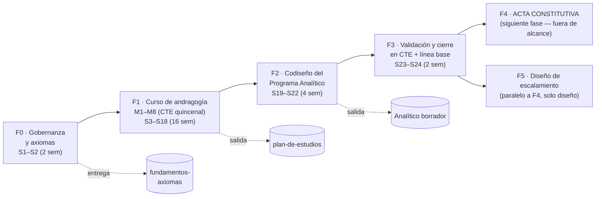

# Roadmap y Cronograma del Proyecto

## Ruta hacia el Acta Constitutiva — sin fechas de calendario (semanas relativas)

*Documento de gobernanza · Segunda Tanda · Versión 1.0 · 26 de septiembre de 2026*
*Decisiones del proyecto: [ADR](adr-modelo-construccion-programa-analitico-curso.md) · FODA/SOACH · [Plan de estudios](plan-de-estudios-curso-andragogia-neuroeducacion.md)*

---

## 0. Principios rectores del roadmap

El roadmap se gobierna con los **axiomas fundacionales AX-1..3** (fuente canónica: [`fundamentos-axiomas-del-programa.md`](fundamentos-axiomas-del-programa.md)):

- **[AX-1]** Cada fase termina **midiendo y retroalimentando**: sin línea base y retrospectiva, la información del ciclo se desperdicia. Cada "error" de fase es insumo de la siguiente.
- **[AX-2]** Las fases invierten primero en los **adultos** (curso M1–M8) antes de exigir resultados en niños: el niño es consecuencia del adulto formado y del entorno diseñado.
- **[AX-3]** Las revisiones de fase son **resignificaciones institucionales**: se pueden abrir tensiones; se acompañan con apertura y se deciden con matices, no a prisa binaria.

**Ancla temporal**: solo secuencia relativa en **semanas (S)** desde el inicio del proyecto (S1). Cada plantel inserta este mapa en su propio calendario.

**Alcance**: piloto en **1 plantel**, diseño escalable.

---

## 1. Roadmap de fases

### 1.1 Fases en detalle

| Fase | Semanas | Actividades clave | Entregables | Definition of Done (DoD) |
|---|---|---|---|---|
| **F0 — Gobernanza y fundamento** | S1–S2 | Aprobación de este paquete; designación de sponsor/coordinador/RACI; **adopción de AX-1..3 (AD-0)**; acreditación de línea base; lectura del README de convención | Acta de arranque interna; roles; línea base v0 | AD-0 aprobado, roles nombrados, Primera Tanda verificada intacta |
| **F1 — Formación andragógica (curso M1–M8)** | S3–S18 | 8 sesiones quincenales de CTE; M1 axiomas; M2–M7 serie D1–D6; M8 laboratorio; asistencia y evidencias de práctica | Evidencias por módulo; borradores del Analítico (tarea M8); perfil de egreso verificado | ≥80% asistencia del equipo clave; 1 entregable por módulo; cuestionario de cierre sin neuromitos (filtro J) |
| **F2 — Codiseño del Programa Analítico** | S19–S22 | Aplicar los 3 planos (lectura de realidad interseccional, contextualización con contenidos nuevos, formulación); secuenciación 1°–2°–3°; KPIs por beneficiario | **Borrador de Programa Analítico** (grado piloto) | Los 3 planos completos; contenidos nuevos listados; KPIs con línea base definida |
| **F3 — Validación y cierre** | S23–S24 | Revisión en CTE; filtro anti-neuromitos; auditoría interseccional de materiales; revisión de guardas de AX; retrospectiva del ciclo | Analítico v1.0 aprobado; retrospectiva F3; registro de riesgos actualizado | Firma interna del colectivo; retrospectiva documentada; checklist de validación (§3) en verde |
| **F4 — Acta Constitutiva** | S25+ (siguiente fase) | Fuera de alcance de este roadmap; se deja el **hito** y los insumos preparados (AD-0, Analítico, axiomas) | — | — |
| **F5 — Diseño de escalamiento** | Paralelo a F4 | Solo **diseño**: criterios de réplica a otro plantel (qué se copia, qué se contextualiza, condiciones mínimas) | Documento de criterios de réplica | Criterios revisados; sin ejecución |

---

## 2. Cronograma relativo (Gantt tabular)

> **Nota metodológica**: se opta por un Gantt **tabular con barras** (más un diagrama de secuencia Mermaid) en lugar de un grantt de fechas: un grantt calendario introduciría fechas absolutas, lo que contradice la decisión del proyecto de trabajar **solo con semanas relativas**. Cada plantel puede volcar estas semanas a su calendario local.

| Fase | S1 | S2 | S3–S4 | … | S17–S18 | S19–S22 | S23–S24 | S25+ |
|---|:--:|:--:|:--:|:--:|:--:|:--:|:--:|:--:|
| F0 Gobernanza | ██ | ██ | | | | | | |
| F1 Curso M1–M8 (quincenal) | | | ▓░ | … | ▓░ | | | |
| F2 Analítico | | | | | | ████ | | |
| F3 Validación | | | | | | | ██ | |
| F4 Acta (hito) | | | | | | | | ▶ |
| F5 Escalamiento (diseño) | | | | | | | ▓▓ | ▓▓ |

**Leyenda**: ██ bloque completo · ▓░ sesiones quincenales alternas · ████ continuo · ▶ hito · ▓▓ trabajo parcial.

**Distribución del curso (F1)**: 8 módulos en 16 semanas = **1 sesión quincenal por módulo** (M1→M8), con tarea de aplicación entre sesiones.

---

## 3. Hitos (milestones)

| ID | Hito | Fin de | Evidencia |
|---|---|---|---|
| H1 | Paquete aprobado y roles activos | F0 | Registro de decisión AD-0 |
| H2 | Curso M1 completado (axiomas discutidos) | S3–S4 | Acta de sesión M1 |
| H3 | Curso M8 completado | F1 | Borrador de Analítico entregado |
| H4 | Analítico v1.0 aprobado | F3 | Firma del colectivo |
| H5 | Retrospectiva y línea base cerradas | F3 | Tablero de KPI con baseline |
| H6 | Acta Constitutiva (fuera de alcance) | F4 | — |

---

## 4. Registro de riesgos (resumen)

| # | Riesgo | Prob. | Impacto | Mitigación (vinculada a principios) |
|---|---|---|---|---|
| R1 | Formación "de un día" → vuelve a la práctica vieja | Alta | Alto | M8 laboratorio + acompañamiento en aula (D4 G18) |
| R2 | Neumitos en materiales comerciales | Alta | Medio | Filtro bloque J en F3 (AX-3) |
| R3 | Burnout docente durante el ciclo | Media | Alto | Carga quincenal moderada; G15; apoyo del sponsor |
| R4 | Axiomas usados como slogan | Media | Medio | Reglas de uso del canónico; verificación en M1 (F9) |
| R5 | Primera Tanda editada por error | Baja | Alto | README + verificación por tamaño/mtime en F3 |
| R6 | Falta de sponsor activo | Media | Alto | H1 condiciona el arranque; RACI explícito |
| R7 | Presión académica prematura que recorte el juego | Media | Alto | D6 R2; auditoría de horario en F3 |
| R8 | Deriva de alcance (agregar sin decidir) | Media | Medio | Control de cambios vía ADR (AD-6) |

---

## 5. Criterios de escala (F5)

Un segundo plantel puede iniciar cuando en el piloto se cumpla:

1. Analítico v1.0 aprobado y en uso ≥1 trimestre.
2. Línea base de KPIs con al menos un ciclo de medición.
3. Retrospectiva F3 con mejoras cerradas.
4. Equipo "multiplicador": ≥2 personas formadas en M1–M8 con disponibilidad de acompañar.
5. Presupuesto/condiciones materiales mínimas verificadas (FODA).

---

*Documento vivo · Mantenimiento en CTE · Control de cambios por ADR (AD-6).*
